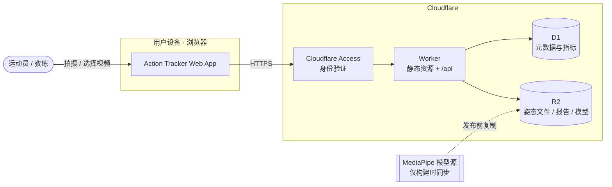
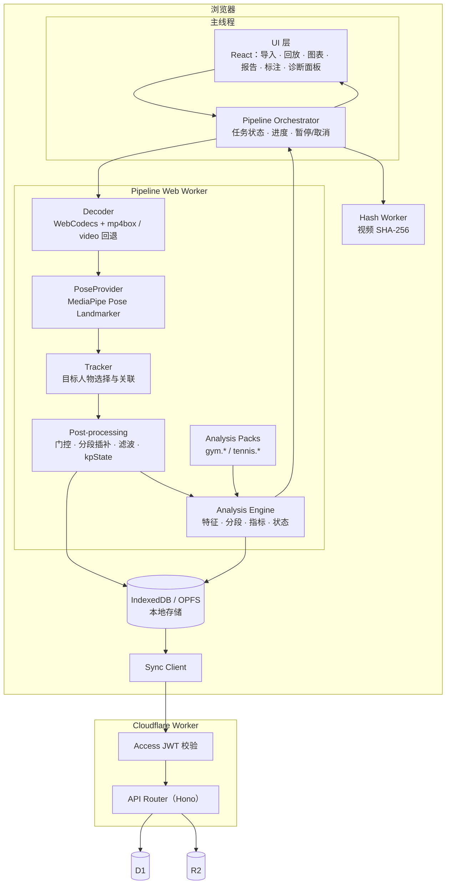
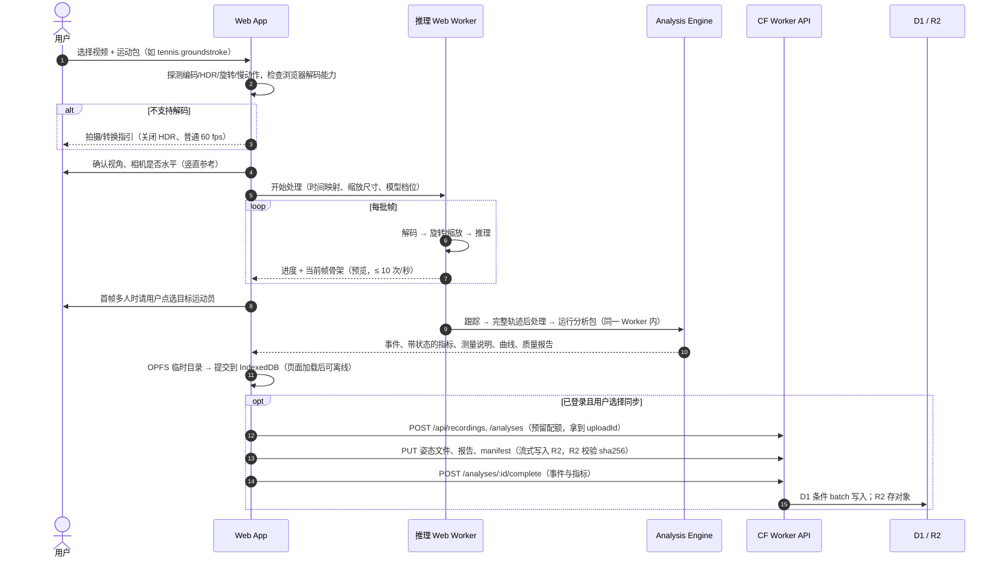

# 01 · 架构总览

> 状态：v0.3 草案 · 更新：2026-10-30（ADR-014 shadcn/Tailwind；P1 脚手架状态；Worker 测试包改名）

## 1. 背景

目标是做一个**网页版运动动作分析工具**：用户上传或拍摄运动视频，系统自动提取人体骨架，并按运动项目给出量化测量。近期两个重点方向：

- **Gym（健身）**：深蹲、俯卧撑、弓步、硬拉、推举等，测量次数、幅度（ROM）、节奏、关节角度、左右对称。
- **Tennis（网球）**：正手、反手、发球，测量挥拍事件、动作阶段、动力链时序、膝关节弯曲、挥拍速度峰值时的身体位置。

## 2. 目标与非目标

### 目标（v1）

1. 浏览器内完成视频 → 骨架 → 测量，无需安装软件；**iPhone Safari 是主平台**（iOS 17+，推荐 18.4+），桌面浏览器次之，Android Chrome 尽力支持（见 [07-mobile-web.md](./07-mobile-web.md)）。
2. 视频**默认只在本地处理**，不上传服务器；典型片段约 **30 s**（Q9）。
3. 骨架叠加回放、关节角度曲线、事件列表（rep / stroke）、**带状态的指标**（valid / unavailable / experimental，及不可用原因）。
4. 运动项目以**分析包（Analysis Pack）**形式插拔，Gym 与 Tennis 共用同一管线。
5. 可选登录后同步姿态数据与指标到 Cloudflare，查看历史趋势（只比较同视角、同参数的有效结果）。
6. 在 Cloudflare **Workers Free** 计划内运行。

### 非目标（v1）

- **动作纠错与训练建议**（Q8：v1 只做测量，见 ADR-012）。
- 医疗级 / 科研级生物力学精度（单目 2D 估计存在系统误差）；受伤风险判断。
- 慢动作文件的速度与节奏测量（时间映射不可信，只用于计数和回放）。
- 冷启动离线（页面未加载时断网使用）和跨设备叠加回放（Q10，见 ADR-002）。
- 球拍、球的检测与轨迹，球场标定（规划在后续阶段）。
- 服务端 GPU 推理、服务端视频转码。
- 多机位 3D 重建。
- 公开注册的多租户 SaaS（v1 使用者为本人 + 少量教练试用；公开发布在 v2 或以后，Q3）。
- 实时摄像头模式（Q5：未来功能，未排期）。
- 云端保存原视频（Q6：暂时只在本地）。

## 3. 约束与已知事实

### 3.1 样例视频 `videos/sample1.MOV`（2026-10-29 解析文件头得出）

| 属性 | 值 | 设计影响 |
|---|---|---|
| 设备 | iPhone 16 Pro 后置摄像头 | iPhone 是主要拍摄来源 |
| 编码 | **HEVC (hvc1) Main10**，Level 5.1 | 非 Safari 浏览器可能无法解码 |
| 色彩 | **HLG HDR**（BT.2020）+ **Dolby Vision** 配置 | 10-bit HDR 进一步降低兼容性 |
| 分辨率 / 帧率 | 3840×2160 @ 59.97 fps | 4K 解码开销大，推理前必须缩放 |
| 方向 | 旋转矩阵 90°，实际显示为**竖屏** 2160×3840 | WebCodecs 路径需自行处理旋转 |
| 时长 / 大小 | 7.72 s / 51 MB（约 55 Mbps） | 上传视频成本高，坚持本地优先 |
| 其他轨道 | AAC + APAC 空间音频、多条元数据轨 | 分析忽略音频；解封装需跳过未知轨 |

视频内容（2026-10-29 用户确认 Q1）：**单腿蹲的一种**，动作慢、画面清晰。用途：P1 管线与**关键关节显示**的参考素材（骨架叠加、旋转、时间轴、髋/膝/踝角度曲线、`kpState`），不作为第一个分析包（Tennis）的验证素材。

### 3.2 Cloudflare Workers Free 关键限制（2026-10-29 核对官方文档）

| 限制 | 值 | 设计响应 |
|---|---|---|
| CPU 时间 | **10 ms / 请求** | Worker 不做推理和重计算，只做 CRUD、鉴权、流式存储 |
| 请求数 | 100,000 / 天 | 客户端批量提交，单次分析约 7–10 个请求 |
| 请求体 | 100 MB（Free 域名计划） | 姿态文件远小于此；视频上传如需要走 R2 预签名 URL |
| 单个静态资源 | 25 MiB | MediaPipe heavy 模型 29.2 MB → 放 R2 |
| 子请求 | 50 / 请求 | D1 使用 `batch()` 合并写入 |
| Workers AI | 无人体姿态模型 | 推理只能在浏览器（或未来的付费 / 外部 GPU） |

详见 [05-cloudflare-platform.md](./05-cloudflare-platform.md)。

## 4. 架构原则

1. **Client-heavy, Edge-light**：所有计算密集任务在浏览器，Worker 只做薄 API。
2. **Local-first & Privacy by default**：视频不出设备；上传的是骨架数据和指标。
3. **Pose Track + manifest 是核心资产**：推理结果保存为标准化姿态文件，并记录完整的分析配方（`recipeHash`）；在明确的范围内（见 ADR-004）分析可随算法升级重新运行，无需重新推理。
4. **确定性分析**：分析包是纯 TypeScript 函数，同样输入得到同样输出，可在浏览器和 Node 测试中复用。
5. **可替换的推理提供者**：通过 `PoseProvider` 接口隔离 MediaPipe，未来可加 RTMPose (ONNX Runtime Web) 或服务端推理。
6. **测量诚实**：每个关键点带观测状态，每个指标带状态与原因；可用性按原始观测判定，插补和重采样不能让指标"变得可测"；测不准就说"不可用"，不输出结论（见 ADR-011）。
7. **免费额度内设计，付费路径可平滑升级**。

## 5. 系统上下文



## 6. 组件视图



主线程只负责 UI、渲染和（`<video>` 回退路径下的）抓帧；解码、推理、后处理、分析、编码与写 OPFS 都在 Pipeline Worker 中完成，详见 [02-pose-pipeline.md](./02-pose-pipeline.md) 第 5 节"线程模型"。

## 7. 端到端流程（离线视频分析）



## 8. 部署拓扑（规划，当前不部署）

- **一个 Worker**：通过 Workers Static Assets 托管 SPA，同一个 Worker 处理 `/api/*` 和 `/models/*`。
- **R2 bucket**：`action-tracker-data`（姿态文件、manifest、报告、标注；不含图片）与 `models/` 前缀（MediaPipe 模型）。
- **D1 database**：`action-tracker`（元数据、事件、指标）。
- **Cloudflare Access**：v1 只用 Access 保护 `/api/*`（`/api/health` 除外）；SPA 和模型公开，匿名用户可完全在本地使用，登录只用于云同步（Zero Trust 免费计划，名额以官方为准）。配置方式为 workers.dev 主机名 + `/api` 路径的 self-hosted 应用，见 [04-data-and-api.md](./04-data-and-api.md) 5.1。
- **域名**：v1 使用 `action-tracker.<子域>.workers.dev`，不需要自定义域名（2026-10-29 用户确认）。
- 环境：`local`（`wrangler dev` / Vite）→ `preview` → `production`；**任何部署都需要用户明确批准**。

## 9. 仓库结构（规划）

```text
sport-action-tracker/
├─ AGENTS.md                 # AI agent 工作规则
├─ workflow.md               # 项目思考与进展日志
├─ designs/                  # 设计文档（本目录）
├─ videos/                   # 本地样例视频（不提交、不修改）
├─ apps/
│  └─ web/                   # Vite + React SPA 与 Worker（@cloudflare/vite-plugin）
│     ├─ src/                # 浏览器端：UI、pipeline 编排、Web Worker
│     ├─ worker/             # Cloudflare Worker：API（Hono）、Access 校验
│     ├─ migrations/         # D1 SQL migrations
│     └─ wrangler.jsonc
├─ packages/
│  ├─ pose-core/             # 标准骨架、几何、滤波、跟踪、PTRK 编解码（纯 TS）
│  ├─ pose-mediapipe/        # PoseProvider 的 MediaPipe 实现
│  ├─ analysis-core/         # 分析引擎、分段工具、规则引擎、Pack 接口
│  ├─ analysis-gym/          # gym.* 分析包
│  ├─ analysis-tennis/       # tennis.* 分析包
│  └─ shared/                # API 类型与 zod schema
├─ fixtures/                 # 姿态文件 + 人工标注（小文件，可提交，用于回归测试）
└─ tools/                    # 批量提取姿态、对比基准（如 Sports2D / RTMPose）的脚本
```

2026-10-30 P1 脚手架已创建：`apps/web`、`pose-core`、`analysis-core`、`analysis-tennis`、`shared`、`fixtures/`。`pose-mediapipe` 在接入推理时创建；`analysis-gym` 推迟到 P2（Tennis 优先，Q2）；`tools/` 暂未创建（离线提取脚本目前在 `designs/mockups/tools/`）。

## 10. 技术选型

| 领域 | 选择 | 理由 |
|---|---|---|
| 语言 | TypeScript（全栈） | 浏览器、Worker、分析包共享类型与代码 |
| 包管理 | pnpm workspaces | monorepo，分析包可独立测试 |
| 前端 | Vite + React | 生态成熟；与 Cloudflare Vite 插件集成 |
| 姿态推理 | `@mediapipe/tasks-vision`（npm 当前 1.2.0，Apache-2.0） | 浏览器原生、GPU delegate、33 点含脚跟脚尖 |
| 解封装 / 解码 | mp4box.js + WebCodecs；回退 `<video>` + `requestVideoFrameCallback` | 帧精确、时间戳准确、可快于实时 |
| 线程通信 | Web Worker + Comlink | 推理不阻塞 UI |
| 图表 | uPlot | 轻量、适合高密度时间序列 |
| UI 组件与样式 | **shadcn/ui（复制进仓库的组件源码，Radix 原语）+ Tailwind CSS v4**；token 用 shadcn 变量名，定义在 [MASTER](./design-system/action-tracker/MASTER.md)（ADR-014） | 选定方案 C 本就按 shadcn maia 风格设计；组件可改源码，无运行时依赖服务；深/浅主题只换变量 |
| 图标 / 字体 | Phosphor（`@phosphor-icons/react`，替换 shadcn 默认的 lucide）；系统字体（iPhone 上为 SF Pro），不打包字体文件 | 风格统一；不在运行时请求外部字体（隐私、离线） |
| 本地存储 | IndexedDB（元数据）+ OPFS（姿态二进制） | 离线可用，大文件高效 |
| API | Hono on Workers | 轻量路由，CPU 开销小 |
| 校验 | zod | 前后端共享 schema |
| 数据 | D1 + R2 | 结构化指标可 SQL 查询；大对象放 R2 |
| 测试 | Vitest 5；Worker 用 `@cloudflare/vitest-plugin`（原 `vitest-pool-workers` 已改名，测试跑在 workerd 中） | 分析包用 fixtures 做黄金测试 |

## 11. 质量属性目标（v1 初值，待原型验证）

| 属性 | 目标 |
|---|---|
| 离线分析耗时 | **iPhone（主平台）**，30 s 1080p60 片段，`full` 或 `lite` 模型：持续运行 ≤ 3× 视频时长，记录各阶段 P50/P95 与降频情况（见 02 第 10 节）；桌面带 GPU 笔记本 ≤ 2× |
| 实时模式（Phase 4） | `lite` 模型 ≥ 24 fps |
| UI 响应 | 推理期间主线程无 >100 ms 卡顿；可随时暂停 / 取消 |
| 测量诚实 | 慢放、插值到更高频率、关键峰值附近漏帧的测试素材中，相关指标**全部**为 `unavailable`，不出现"看起来可用"的数值 |
| 确定性 | 相同 PTRK + manifest 重算，结果逐字节一致 |
| Gym 计数准确率 | 符合拍摄规范的视频 ≥ 95%（初值），报告样本量、误检与漏检；调参素材与验证素材分开 |
| Tennis 挥拍事件检测召回率 | 符合拍摄规范的视频 ≥ 90%（初值），同上 |
| 隐私 | 未经明确同意，视频字节和视频截图不离开设备 |
| 成本 | Workers Free + R2/D1 免费额度内（v1 为本人 + 少量教练；全量同步的容量问题 Q11 暂不处理，见 05 第 3 节） |

## 12. 主要风险

| 风险 | 级别 | 缓解 |
|---|---|---|
| iPhone HEVC 10-bit HDR 在 Chrome/Edge/Firefox 上无法解码 | 高 | 能力探测；Safari 直通；拍摄指引（关闭 HDR）；后期评估本地转码 |
| 单目 2D 角度受拍摄角度影响大 | 高 | 每个分析包定义拍摄规范；检测视角偏差；竖直参考由用户确认；测不准时指标为 `unavailable` |
| 慢动作 / 可变帧率导致时间错误 | 高 | 时间模型（`timeMap`）；慢动作文件的时间相关指标不可用；拍摄指引用普通 60 fps |
| 网球挥拍快，60 fps 模糊、关键点丢失 | 中 | 充足光线、机型支持时 120 fps 普通视频；挥拍窗口内观测充分性判定 |
| 多人画面（对手、健身房其他人）误跟踪 | 中 | 用户点选目标 + 跨帧关联 + 人工修正；人物切换处断开后处理 |
| 设备性能差异大 | 中 | 模型档位自动选择、仅在必要时降帧（只限 Gym，P2 对比后；网球不降帧）、进度与取消 |
| 手机端内存上限、后台挂起、发热降频、相册导出转码 | 中 | 小解码队列、同页暂停/继续、Wake Lock、移动端默认参数；详见 [07-mobile-web.md](./07-mobile-web.md) |
| 用户把测量值理解为动作评价 | 中 | v1 只做测量（ADR-012）；指标附状态与说明；不提供默认阈值 |
| MediaPipe API / 模型变更 | 低 | 锁定版本；模型自托管并记录 SHA-256；`PoseProvider` 抽象 |
| 网球优先（Q2）：挥拍快，第一个包难度高于周期性 Gym 动作 | 中 | P1 先用 sample1 打通管线与关节显示；网球包只做测量、观测不足就标为不可用；尽早拍摄符合规范的网球素材并手写标签 |
| 免费额度不足 | 低–中 | 计算在客户端；v1 使用者为本人 + 少量教练，暂不处理（Q11），P3 前复核 |

## 13. 路线图

| 阶段 | 内容 | 云端 |
|---|---|---|
| **P0 设计**（当前） | 架构、数据格式、分析包定义 | 无 |
| **P1 本地原型** | **首个里程碑：iPhone 上的最小闭环**——选择 sample1.MOV（单腿蹲，慢、清晰）→ 解码（含旋转、HDR、时间映射）→ 推理 → 骨架叠加回放并**突出显示重要关节**（髋、膝、踝及其角度曲线）→ 写 PTRK + manifest → 读回校验 → 诊断面板显示各阶段耗时。之后：完整轨迹后处理与 `kpState`、**`tennis.groundstroke` v0**（只测量：挥拍事件、正/反手分类、阶段、屈膝等）、手写网球 labels 与反例 fixtures、同页暂停/继续、导出并实测导入 | 无（`vite dev`，手机测试用本地 HTTPS） |
| **P2 分析包 v1** | Tennis：`tennis.serve`、groundstroke 完善；Gym：squat / 单腿蹲 / push-up / lunge；标注工具 UI；fixtures 回归测试 | 无 |
| **P3 云同步** | Worker API、D1、R2、Access（本人 + 少量教练试用）；配额预留、条件状态迁移、墓碑清理；历史与趋势 | 需用户批准后部署 |
| **P4 离线与体验** | PWA 与冷启动离线；实时摄像头模式为**未来功能**（Q5，未排期） | 同上 |
| **P5 进阶** | 球拍/球检测（ONNX Runtime Web）、球场标定、RTMPose 提供者、目标模式（用户自设目标对比）、Workers AI 文字总结、可选视频上传 / 服务端推理（付费） | 评估付费 |
