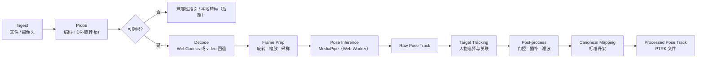

# 02 · 视频与姿态管线

> 状态：v0.3 草案 · 更新：2026-10-30（新增第 13 节 P1 实现备注：sample1 端到端）

管线把一个视频文件（或摄像头流）转换为**已处理的标准姿态轨迹（Processed Pose Track）**，供分析引擎使用。全部在浏览器中执行。



## 1. Ingest（导入）

| 来源 | v1 | 说明 |
|---|---|---|
| 本地文件 `<input type=file>` / 拖放 | ✅ | 主路径。`File` 对象直接读取，不上传 |
| 摄像头 `getUserMedia` | 未来功能（Q5，未排期） | 实时模式，主要用于 Gym |
| 云端已存视频 | P5 | 仅在用户选择上传视频后 |

导入时在浏览器计算视频 **SHA-256**，作为本地与云端的视频身份标识，用于去重和关联，而无需上传视频本身。

- `crypto.subtle.digest()` **不支持增量输入**，对大视频会把整个文件读进内存（手机上风险尤其高）。改用支持流式更新的 WASM 哈希库（如 hash-wasm），用 `File.stream()` 分块计算，并在 Web Worker 中运行。
- 哈希只用于身份识别，不阻塞分析：与解码并行计算。

## 2. Probe（探测）

用 mp4box.js 读取 `moov` 信息：编码（`hvc1`/`avc1`）、profile/位深、色彩（`colr`：BT.2020 / HLG / PQ）、Dolby Vision 配置（`dvvC`）、`tkhd` 旋转矩阵、时长、帧数、帧率（由 `stts` 计算）。

再进行**能力探测**：

1. `VideoDecoder.isConfigSupported({ codec, codedWidth, codedHeight, description })`（WebCodecs 路径）
2. `HTMLVideoElement.canPlayType('video/mp4; codecs="hvc1..."')`（回退路径）
3. 试解码第一帧验证（`isConfigSupported` 可能乐观返回）。

### HEVC / HDR 兼容策略

样例视频是 iPhone 默认的 **HEVC Main10 + HLG + Dolby Vision**。不同浏览器支持程度取决于浏览器版本、操作系统和 GPU，**必须运行时探测，不能按浏览器名称硬编码**。

| 情况 | 处理 |
|---|---|
| 可解码 | 正常处理，但 HDR → SDR 转换（BT.2020/HLG → sRGB 色调映射）**会改变输入像素和对比度，可能影响关键点精度**，且 WebCodecs、Canvas、`<video>` 路径的转换结果可能不同。v1 统一一条转换路径（解码帧 → 绘制到 sRGB 的 OffscreenCanvas / `createImageBitmap`），P1 spike 用同一帧比较不同路径、HDR 与 SDR 版本的关键点差异 |
| 不可解码 | 提示用户：① 用 Safari 打开；② iPhone 设置 → 相机 → 格式 → "兼容性最佳"（H.264）并关闭 HDR 视频；③ 用系统工具导出为 H.264 |
| 后期选项 | 本地转码（ffmpeg.wasm）仅对短片段可行，4K 10-bit 会非常慢，P1 spike 评估后再决定 |

**推荐拍摄规格**（写入每个分析包的拍摄规范；iPhone 细节见 [07-mobile-web.md](./07-mobile-web.md) 4.1）：1080p、关闭 HDR、三脚架固定；Gym 30–60 fps；Tennis 60 fps（机型支持时可用 120 fps **普通视频**）。**慢动作模式拍摄的文件只用于计数和可视化**，不输出依赖真实时间的指标（见第 3 节"时间模型"）。单段视频建议 ≤ 30 s。

## 3. Decode（解码）

### 路径 A：WebCodecs + mp4box.js（首选）

- mp4box.js 解封装 → `EncodedVideoChunk` → `VideoDecoder` → `VideoFrame`。
- 优点：帧精确、使用容器真实时间戳、可快于实时、无丢帧。
- 注意：
  - `VideoFrame` 是**未旋转**的编码帧，需按 `tkhd` 矩阵自行旋转。
  - 必须及时 `frame.close()`，并限制解码队列深度（背压），避免 4K 帧耗尽显存。
  - QuickTime `.MOV` 中的多条元数据轨（`mebx`）、APAC 音频需忽略。
  - 时间戳使用**显示时间（CTS）**，处理 edit list（`elst`）偏移；HEVC 存在 B 帧重排，解码输出顺序需按 CTS 校验。
  - 送入 MediaPipe 的毫秒时间戳必须**严格递增**；若两帧四舍五入后毫秒相同（如 240 fps），使用微秒级源时间映射为单调递增的整数毫秒并保留原始时间戳用于分析。

### 路径 B：`<video>` + `requestVideoFrameCallback`（回退）

- 播放或逐帧 seek，用 `metadata.mediaTime` 作为时间戳。
- 浏览器自动处理旋转。
- **限制**：`requestVideoFrameCallback` 的回调频率不超过"视频帧率与屏幕刷新率中的较低者"，120/240 fps 视频在 60 Hz 屏幕上会丢帧；逐帧 seek 也不保证帧精确。
- **适用范围**：预览、实时摄像头、低帧率 Gym 分析。若事件窗口内的原始有效观测达不到分析包要求（Tennis 通常如此，判定方法见下方"时间模型"），**相关指标标记为 `unavailable`**，只显示骨架预览并提示更换浏览器。

### 时间模型（三种时间）

| 时间 | 定义 | 来源 |
|---|---|---|
| **播放时间** `tPlay` | 文件中每帧的显示时间（CTS，考虑 edit list） | 容器 |
| **运动时间** `tReal` | 动作在现实中发生的时间 | `tPlay` 经时间映射得到 |
| **处理采样率** `fs` | 后处理重采样后的均匀采样率 | 分析包配置；只是计算网格，**不代表真实观测密度** |

- **时间映射** `timeMap`：记录 `tPlay → tReal` 的映射、来源与可信度。正常视频为恒等映射（`source: "identity"`, `trusted: true`）。
- **慢动作**：探测到容器帧率 ≥ 100 fps、edit list 存在变速段，或文件来自 iOS 慢动作模式时，`timeMap.trusted = false`。v1 **不尝试恢复真实时间**：只做计数、分段与可视化，所有依赖真实时间的指标（速度、节奏、时长）标记为 `unavailable`，原因为"时间映射未知"。分段变速的完整映射留到后续。
- **观测充分性**（替代简单的 `minFps`）：分析包声明 `observation` 要求，例如事件关键窗口内关键关节的**最大原始观测间隔**和**最低有效观测比例**。判定只看 raw 中真实观测到的点（`kpState = observed`），**重采样和插补出的点不计入**。因此"30 fps 插值到 120 Hz"不能满足 Tennis 的要求；全片平均帧率合格但关键挥拍窗口连续漏检，也不合格。

## 4. Frame Prep（帧准备）

1. **旋转**：按显示方向输出（样例：竖屏 2160×3840）。
2. **缩放**：长边缩到 `inferenceLongEdge`（默认 1280，低端设备 960）。MediaPipe 内部输入只有 256×256 级别，4K 原图只增加开销。用 `createImageBitmap(frame, { resizeWidth, resizeHeight })` 或 OffscreenCanvas。
3. **采样**：
   - **默认处理全部帧**（建议片段 ≤ 30 s，60 fps 约 1,800 帧）。
   - Gym 隔帧采样（60 → 30 fps）只作为**性能降级选项**：先在 P2 实现 Gym 包时用同一素材对比全帧与隔帧的计数、关键时刻和指标，误差在容限内才允许设备性能不足时启用。注意隔帧前没有抗混叠处理，之后的低通滤波不能消除已经引入的混叠。
   - Tennis：始终处理全部帧。
4. **ROI（后期）**：网球远端球员在画面中很小，可对目标人物裁剪放大后再推理，坐标映射回原图。

## 5. Pose Inference（推理）

### PoseProvider 接口

```ts
export interface PoseProvider {
  readonly id: string;               // 例："mediapipe.pose_landmarker_full@tasks-vision-1.2.0"
  readonly skeleton: SkeletonSpec;   // 原生关键点定义（MediaPipe 为 33 点）
  init(options: {
    delegate: 'GPU' | 'CPU';
    maxPoses: number;                // Gym 默认 1–2；Tennis 默认 2–4
    minPoseConfidence: number;
  }): Promise<void>;
  // MediaPipe 的 detectForVideo() 是同步调用；接口保持同步，异步由 Web Worker 边界提供
  detect(frame: ImageBitmap | VideoFrame, timestampMs: number): RawPoseFrame;
  dispose(): void;
}

export interface RawPoseFrame {
  timestampMs: number;
  poses: Array<{
    image: Float32Array;     // [x, y, z, visibility] × K，x/y 归一化到图像宽/高
    presence?: Float32Array; // × K，模型输出 presence 时保留（tasks-vision 1.2.0 中为可选字段）
    world?: Float32Array;    // [x, y, z, visibility] × K，单位米，以髋部中心为原点（模型估计）
  }>;
}
```

`visibility` / `presence` 是模型对"点是否可见 / 是否在画面内"的估计，**不是角度或指标的正确率**，不能直接当作结果置信度展示。

### MediaPipe 配置

- 运行在**管线 Worker**（见下方"线程模型"），`runningMode: 'VIDEO'`，时间戳严格递增（见第 3 节）。
- **GPU delegate 在 Worker 中的初始化顺序**：
  1. 在 Worker 内创建 `OffscreenCanvas`，探测能否获取 `webgl2` 上下文（iOS 需 17+）；
  2. 可用时通过 `VisionTaskOptions.canvas` 传入该 OffscreenCanvas，并设置 `delegate: 'GPU'`；
  3. 初始化失败或推理过程中出错（如 WebGL context lost）时，**销毁实例并重建为 CPU 实例**，从失败帧之前的关键帧重新解码，带约 1 s 重叠预热后继续。回退点记录为**推理分段边界**（写入 manifest 与 PTRK flags），不承诺分段前后数值无缝一致。
- `detectForVideo()` 同步执行，会阻塞所在 Worker；Worker 内按批（例如每 10 帧）回报进度并让出事件循环。
- WASM 资源与模型**自托管并锁定版本**，不在运行时依赖第三方 CDN；模型文件的 SHA-256 在构建时计算并写入模型清单，用于 manifest。

### 线程模型

| 线程 | 职责 |
|---|---|
| 主线程 | 文件选择、UI、骨架与曲线渲染、任务控制（开始 / 暂停 / 取消）；路径 B 回退时在此取帧（`createImageBitmap`）并以 transferable 传给 Worker |
| **管线 Worker**（一个） | 顺序执行：解码 → 帧准备 → 推理 → 目标跟踪 → 后处理 → 分析包 `analyze()` → PTRK 编码与压缩 → 写 OPFS |
| 哈希 Worker | 视频 SHA-256（与管线并行，见第 1 节） |

- v1 不做线程池；各阶段在同一 Worker 中顺序调度，避免多份大数组拷贝。
- **取消与暂停**：Worker 在每批之间检查控制消息（普通 `postMessage` 即可，不需要 `SharedArrayBuffer`），因此取消的响应延迟 ≤ 一批的处理时间；后处理和分析也按关节或事件分批，不做一次性长循环。
- 大数组在线程间传递时使用 transferable（转移所有权，不复制）；进度与预览消息限频（≤ 10 次/秒）。
- 诊断面板按阶段分别计时：解码、推理、跟踪、后处理、分析、保存。

| 模型档位 | 大小 | 用途 | 托管位置 |
|---|---|---|---|
| `lite` | 5.5 MB | 实时模式、低端设备 | 静态资源 |
| `full` | 9.0 MB | **离线分析默认** | 静态资源 |
| `heavy` | 29.2 MB | 网球等高精度离线分析 | R2（超过 25 MiB 静态资源上限），经 `/models/*` 路由并长缓存 |

档位选择：根据运动包建议 + 设备基准测试（首次运行测量 20 帧耗时）自动选择，用户可覆盖。

## 6. Target Tracking（目标人物）

MediaPipe 每帧独立输出多个人体，不保证跨帧 ID 一致。

1. 每帧计算每个姿态的包围框与躯干中心。
2. 帧间关联：包围框 IoU + 关键点平均距离构造代价，贪心或匈牙利匹配，生成 `personTrack`。
3. **目标选择**：单人时自动选择；多人时在首个清晰帧让用户点选；默认候选为画面中最大且最居中的人。
4. 允许在回放中手动修正（某时间段切换目标）。
5. 输出：只保留目标运动员的轨迹进入后处理。
6. **"原始"的定义**：PTRK 中的 raw 轨迹指"已选定目标、未滤波"的单人轨迹。多人原始检测结果（每帧人数可变、带 track ID）不进入 PTRK v1，只在调试模式下另存为 `detections.debug.json`，不做同步。
7. 同一视频中有多名运动员需要分析时，为每个目标分别创建一次分析（见 [04-data-and-api.md](./04-data-and-api.md)）。

## 7. Post-processing（后处理）

后处理在**完整的目标轨迹**上统一执行一次（不按分块分别滤波再拼接，避免边界伪影）。顺序固定如下：

| 步骤 | 方法 | 参数（初值） |
|---|---|---|
| 坐标转换 | 归一化坐标 × 显示宽高 → 像素坐标（**计算角度前必须做，否则竖屏视频角度会失真**） | — |
| 置信度门控 | `visibility < 0.5` 的点标为 `missing` | 阈值可由分析包覆盖 |
| 异常值剔除 | 相邻帧位移超过 `k × 躯干长度` 视为跳变，标为 `rejected` | k = 0.5（Gym）/ 1.5（Tennis，手腕运动快） |
| **缺口识别** | 在重采样**之前**，按关键点找出连续缺失段；同时标记人物切换、推理分段边界、`timeMap` 不可信段为**硬边界** | — |
| 缺失插补 | 只填补短缺口（≤ 100 ms），三次插值，标为 `interpolated`；长缺口和硬边界**不连线**，保持 `missing` | ≤ 100 ms |
| 时间重采样 | 在每个连续有效段内，按真实时间戳插值到**固定采样率** `fs`（滤波和求导都假设均匀采样）；不跨越长缺口和硬边界 | `fs` = 分析包配置 |
| 平滑（离线） | 零相位 Butterworth 低通（filtfilt），在每个连续段内执行 | Gym 6 Hz；Tennis 躯干 8 Hz、手臂 12–15 Hz；**截止频率必须 ≤ 0.4 × fs / 2**，不满足时降低截止频率或将依赖该信号的指标标为 `unavailable`（例如 30 fps 不能用 15 Hz） |
| 平滑（实时） | One Euro Filter | 低延迟 |
| 尺度归一 | 以躯干长度（肩中点–髋中点）为单位；已知身高时换算近似米 | — |

**逐点来源 `kpState`**：每帧每个关键点记录 `observed`（模型真实观测）、`interpolated`（短缺口插补）、`missing`、`rejected`（异常值剔除）。processed 轨迹中由重采样产生的点继承相邻原始观测的状态：两侧都是 `observed` 才算 `observed`，否则为 `interpolated`。分析包据此判断**关键窗口是否依赖插补**（见 [03-analysis-packs.md](./03-analysis-packs.md) 第 6 节）。

每帧另有 `flags` 位字段（见第 9 节）：是否检测到人、是否有插补点、是否多人冲突、是否低于质量阈值、推理分段边界。

**坐标空间**：分析结果必须注明测量空间——`image`（图像平面投影，像素 / 躯干长度）或 `world`（模型估计的 3D，米）。两者都不是真实生物力学测量；"近似 m/s"等换算值在报告中必须标注为估计。

## 8. 标准骨架（Canonical Skeleton v1）

分析包只依赖标准骨架名称，不依赖具体模型的索引，以便替换推理提供者。

| 标准名称 | MediaPipe 索引 | COCO-17 索引 |
|---|---|---|
| `nose` | 0 | 0 |
| `left_shoulder` / `right_shoulder` | 11 / 12 | 5 / 6 |
| `left_elbow` / `right_elbow` | 13 / 14 | 7 / 8 |
| `left_wrist` / `right_wrist` | 15 / 16 | 9 / 10 |
| `left_index` / `right_index` | 19 / 20 | — |
| `left_hip` / `right_hip` | 23 / 24 | 11 / 12 |
| `left_knee` / `right_knee` | 25 / 26 | 13 / 14 |
| `left_ankle` / `right_ankle` | 27 / 28 | 15 / 16 |
| `left_heel` / `right_heel` | 29 / 30 | — |
| `left_foot_index` / `right_foot_index` | 31 / 32 | — |

派生点：`mid_shoulder`、`mid_hip`、`neck`（≈ 肩中点）。分析包通过 `requirements.keypoints` 声明依赖，缺失时管线给出明确错误。

PTRK 文件保存提供者的**原生关键点**（MediaPipe 为 33 点，不丢信息），header 中记录原生骨架名与到标准骨架的映射；分析包通过 `pose-core` 的标准名称访问器读取。

## 9. 姿态文件格式 PTRK v1

一个二进制文件，存储在本地 OPFS，同步时上传到 R2。一个 PTRK 文件只包含**一名目标运动员**的单条轨迹（见第 6 节）。

```text
┌──────────────────────────────────────────────┐
│ magic "PTRK" (4B) │ version u16 │ headerLen u32 │   全部数值为 little-endian
├──────────────────────────────────────────────┤
│ header (UTF-8 JSON)，补齐到 8 字节对齐         │
├──────────────────────────────────────────────┤
│ timestamps   Float64[F]       │ raw：源视频播放时间 tPlay（ms，CTS，保留小数）；processed：均匀网格时间
│ flags        Uint8[F]         │ 每帧位字段（见下）
│ kpState      Uint8[F×K]       │ 每个关键点的来源：0 observed，1 interpolated，2 missing，3 rejected
│ image        Int16[F×K×4]     │ x, y, z：像素 ×4（0.25 px 精度）；visibility ×10000
│ presence     Int16[F×K]       │ 仅当 header.hasPresence = true：presence ×10000
│ world        Int16[F×K×4]     │ 仅当 header.hasWorld = true：x, y, z 毫米；visibility ×10000
└──────────────────────────────────────────────┘
整体再用 CompressionStream('gzip') 压缩
```

- **缺失值**：`-32768`（Int16 最小值）表示该分量缺失；未检测到人的帧，所有关键点均为缺失。
- **flags 位定义**：bit0 检测到目标人物；bit1 存在插补点；bit2 多人冲突（目标关联不确定）；bit3 低于质量阈值；bit4 由 CPU 回退推理产生；bit5 推理分段边界（delegate 切换或恢复点）；bit6–7 保留。
- **image.z**：MediaPipe 图像坐标中的相对深度，与 x 同尺度，按"像素 ×4"存储；仅作参考，分析不得把它当作真实深度。
- 版本规则：新增字段只能追加在 header 中；二进制布局变化必须升级 `version`，读取端保持对旧版本的兼容。**PTRK v1 在 P1 首个分析包完成前视为未定版**，定版后才适用兼容规则。

**读取校验**（导入外部文件或读取 OPFS 时都执行，防止坏文件耗尽内存）：

- 限制压缩文件大小（≤ 20 MB）、解压后大小（≤ 100 MB）、header 长度（≤ 64 KB）、帧数（≤ 30,000）和 K（≤ 256）；解压时流式计数，超限立即中止。
- 校验各段长度与 `F`、`K` 一致；时间戳严格递增且有限；数值不得为 NaN / Infinity；`kpState` 只能取已定义值。

Header 示例：

```json
{
  "schema": "ptrk/1",
  "skeleton": "mediapipe-pose/33",
  "canonicalMap": "canonical/1",
  "keypoints": ["nose", "left_eye_inner", "..."],
  "frames": 463,
  "video": {
    "sha256": "…",
    "durationMs": 7718,
    "fps": 59.97,
    "displayWidth": 2160,
    "displayHeight": 3840,
    "rotation": 90,
    "codec": "hvc1",
    "hdr": "hlg"
  },
  "provider": { "id": "mediapipe.pose_landmarker_full@tasks-vision-1.2.0", "modelSha256": "…", "delegate": "GPU" },
  "hasWorld": true,
  "hasPresence": false,
  "timeMap": { "source": "identity", "trusted": true },
  "inferenceSegments": [{ "fromMs": 0, "toMs": 7718, "delegate": "GPU" }],
  "processing": { "stage": "processed", "resampleHz": 60, "inferenceLongEdge": 1280, "frameStride": 1, "filters": ["butterworth-6hz"] },
  "target": { "personTrackId": 0, "selection": "auto-single", "revisions": [] },
  "createdAt": "2026-10-29T07:00:00Z"
}
```

`processing.stage` 为 `raw`（已选目标、未重采样、未滤波，时间戳为源视频播放时间）或 `processed`（已重采样到 `resampleHz` 并滤波）。

**大小估算**：10 s @ 60 fps（600 帧）、K = 33：image 与 world 各约 158 KB，kpState 约 20 KB，加上时间戳和 flags 约 0.34 MB，gzip 后约 0.2–0.3 MB。每次分析保存 raw 和 processed 两份，因此约 **0.4–0.6 MB / 10 s**；典型 30 s 片段约 **1.2–1.8 MB**。

Int16 量化范围检查：像素 ×4 可表示 ±8191 px（4K 长边 3840 ✓，超出画面的点截断到该范围）；world 毫米可表示 ±32 m ✓；`-32768` 保留为缺失值。

## 10. 性能预算（P1 spike 需实测）

以 sample1.MOV（463 帧，4K HEVC）和一段按拍摄建议录制的 30 s 1080p60 视频为基准，在 iPhone 上记录：

| 阶段 | 记录指标 |
|---|---|
| 解码 | 每帧耗时、是否快于实时、内存峰值 |
| 缩放 | 每帧耗时 |
| 推理 | lite / full × GPU / CPU 每帧耗时（heavy 仅桌面） |
| 跟踪 + 后处理 + 分析 + 保存 | 各阶段总耗时 |
| 持续运行 | 30 s 视频全程每帧推理耗时分布（P50 / P95），观察发热降频 |
| 总耗时 | 与视频时长之比（目标 ≤ 3×） |

结果记录在 [workflow.md](../workflow.md)，并据此调整默认档位和采样率。首次运行的 20 帧基准只用于选择档位，**不代表持续性能**。

## 11. 分析配方（manifest）与重算边界

只有 `packVersion + providerId` 不足以复现结果。每次分析保存一份 **manifest**（JSON，随报告存储），记录得到该结果所需的全部输入：

| 类别 | 内容 |
|---|---|
| 输入 | 视频 SHA-256、raw / processed PTRK 的 SHA-256 |
| 推理 | 提供者 ID、模型 SHA-256、delegate 与推理分段、`inferenceLongEdge`、`frameStride`、ROI |
| 坐标与时间 | 旋转矩阵、显示尺寸、`timeMap` |
| 目标 | 目标选择方式与每次人工修正 |
| 后处理 | 版本号与全部参数（门控阈值、插补上限、`fs`、滤波截止频率） |
| 分析 | pack ID、pack 版本、**实际使用的 config 快照**、**运动员档案快照**（身高、持拍手、视角） |

- `recipeHash` = manifest 规范化 JSON（键排序）的 SHA-256。只改一个阈值也会得到不同的 `recipeHash`。
- 运动员档案后来修改，**不影响**旧报告；历史报告始终按自己的快照解释。
- 相同 PTRK + 相同 manifest + 相同 pack 版本，重复运行必须得到相同结果（回归测试项）。

**重算边界**（三层）：

| 想改变的内容 | 需要的输入 | 是否需要原视频 |
|---|---|---|
| 分析规则、阈值、分析包版本 | processed PTRK | 否 |
| 后处理参数（滤波、插补、`fs`） | raw PTRK | 否 |
| 推理模型、找回其他人物、提高真实观测帧率、修正选人错误 | 原视频 | **是** |

raw 已经是"选定目标、可能降采样"后的数据，因此**不承诺**任何算法升级都能免推理重算。

## 12. 暂停、恢复与取消（v1 范围）

视频片段通常 ≤ 30 s，v1 只保证同一页面内的恢复：

| 场景 | v1 行为 |
|---|---|
| 用户点暂停 / 页面切到后台（`visibilitychange`） | 在批次边界暂停，保留内存中的 raw 轨迹和跟踪状态；回到前台后从**上一关键帧**重新解码，用约 1 s 重叠帧预热推理与跟踪，再继续 |
| GPU 失败回退 CPU | 同上，记录推理分段边界（第 5 节） |
| 用户取消 | 在批次边界停止，丢弃未完成结果 |
| 页面被系统回收 / 刷新 / 崩溃 | **重新分析**（需重新选择视频）。启动时检查 OPFS 中未提交的分析目录并清理，不留下损坏数据 |

- 分析结果**只在全部完成后**一次性提交：先写 OPFS 临时目录，最后写 IndexedDB 记录标记完成；OPFS 与 IndexedDB 之间没有原子事务，启动时以 IndexedDB 记录为准，清理没有对应记录的 OPFS 目录。
- "恢复后结果等价"按容差判定：计数一致、关键时刻误差 ≤ 2 帧、指标误差在 P1 实测确定的容限内；不要求与不中断运行逐位一致。
- 跨页面重载的分块续跑留到需要长视频时再设计。

## 13. P1 实现备注（2026-10-30，sample1 端到端）

已实现：导入 → mp4box 探测 → WebCodecs 解码（带背压）→ 旋转缩放 → MediaPipe full 推理 → raw PTRK + manifest 写入 OPFS → 骨架叠加回放 → 分阶段耗时报告。代码见 `apps/web/src/pipeline/`、`packages/pose-mediapipe`、`packages/pose-core/src/ptrk.ts`。

实现中确定的细节（不改变上文设计）：

- **WASM 用 module 版**：管线 Worker 是 module worker，`FilesetResolver.forVisionTasks(base, true)` 通过动态 `import()` 加载 `vision_wasm_module_internal.{js,wasm}`（13.8 MB，tasks-vision 1.2.0 没有 module + nosimd 组合，iOS 16.4+ 支持 SIMD）。
- **必须自己传 OffscreenCanvas**：tasks-vision 按 UA 判断 OffscreenCanvas 是否可用，iPhone 上的 Chrome/Edge（UA 不含 `Version/x`）会被误判，在 Worker 里调用 `document` 崩溃。实现总是传入 `new OffscreenCanvas(1, 1)`。
- **自托管资源**：`apps/web/scripts/prepare-vendor.mjs` 在 `dev` / `build` 前把 WASM 复制到 `public/vendor/tasks-vision-1.2.0/`，并从**版本化 URL** `…/pose_landmarker_full/float16/1/…` 下载模型、校验固定 SHA-256（`5134a3aa…`）。`…/latest/…` 的文件字节不同，不使用。`public/_headers` 给 `/vendor/*` 设一年 immutable 缓存（路径带版本号）。这些文件不进 git。
- **开发服务器**：Vite dev 会给相对路径的动态 `import()` 加 `?import` 并拒绝 `public/` 文件，所以 `wasmBase` 用绝对 URL（`origin + /vendor/...`）；生产构建不受影响。
- **raw PTRK 的 kpState**：模型返回的点在 raw 中一律为 `observed`，`visibility < 0.5` 的门控留在后处理（processed）阶段；回放时 `visibility < 0.5` 的点画空心点、骨线画虚线，只是显示规则。tasks-vision 1.2.0 会输出 presence，`hasPresence = true`。
- **PTRK 读写放在 `@action-tracker/pose-core/io`** 入口（需要 `TextEncoder`、`CompressionStream`、`crypto.subtle`），主入口保持平台无关，分析包在类型层面就用不到这些 API。
- **提交标记**（2026-10-30 本地历史实现后）：顺序为 `raw.ptrk.gz` → `manifest.json`（含 `source.fileName` 和 `run` 运行摘要，两者都在 recipe 之外，不影响 `recipeHash`）→ IndexedDB 记录（同一事务写 `recordings` 与 `analyses`）。IndexedDB 记录是完成标记。管线运行期间持有 Web Lock `action-tracker:analysis:<id>`。
  - **启动对账**（对第 12 节规则的细化）：OPFS 中没有记录的目录，若持有锁（其他标签页正在运行）则跳过；若 `manifest.json` 合法且 `raw.ptrk.gz` 通过 PTRK 读取校验，则**重建记录**（标"Recovered"，覆盖"两次写入之间崩溃"的情况）；否则删除。有记录但文件已不在的（系统清理存储），列表中标"Pose data missing"，只能删除。
  - **删除顺序**：先删 OPFS 目录，再在一个事务里删分析记录（及无其他分析的视频记录）。先删记录会让对账把它恢复回来。
  - OPFS 目录仍是扁平的 `analyses/<id>/`，不按 04 第 6 节的 `/{recordingId}/{analysisId}/` 分层：视频身份按 SHA-256 在 IndexedDB 中去重，扁平目录让对账更简单。
- **recipeHash** 不含 `analysisId`、`createdAt`，相同输入和配方得到相同哈希。
- 暂未实现：多人跟踪（`numPoses = 1`，自动单人）、后处理与 processed PTRK、推理中途 GPU→CPU 回退（只在初始化时回退）、暂停/恢复、路径 B 回退解码。
- **本地历史**（2026-10-30）：底部标签栏"Records / Import / Settings"（08 第 3 节）。Records 列出 IndexedDB 中的分析；打开后从 OPFS 读取 PTRK。原视频不保存：先**只播放骨架**（自带时钟，可播放、逐帧、变速），用户可"Choose original video"，按 SHA-256 校验是同一视频后恢复叠加回放。首次保存后调用 `navigator.storage.persist()`。代码在 `apps/web/src/storage/`（`idb.ts`、`analyses.ts`）和 `src/features/records/`。

**准确性核对**（桌面 Chromium，sample1 的 360 × 640 H.264 副本）：浏览器 full 模型与离线 Python heavy 模型相比，232/232 帧都检出，13 个身体关键点平均相差 2.8 px（画面高度的 0.44%），P95 6.4 px；时间戳差 ≤ 0.5 ms；视频 SHA-256 与本地文件一致。说明旋转、缩放、坐标换算和时间戳都正确。
