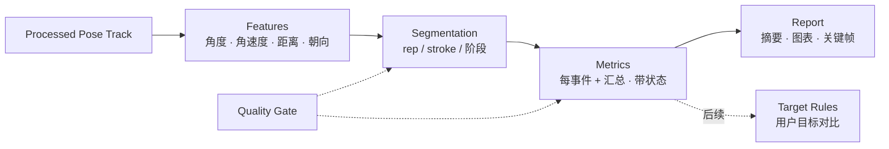
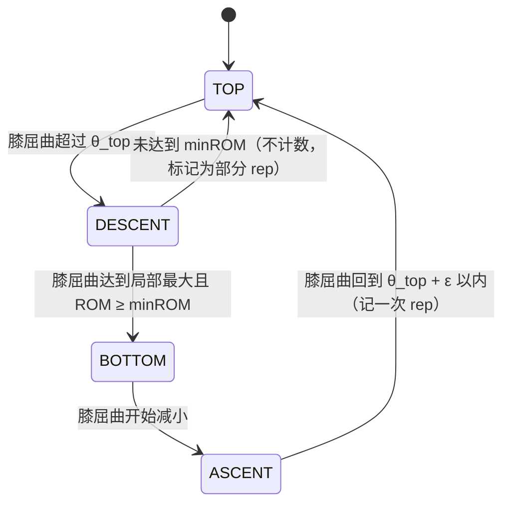

# 03 · 分析引擎与运动包

> 状态：v0.3 草案 · 更新：2026-10-30（Q12 / ADR-015：持拍手与反手类型来自运动员档案；4.3 正面 / 侧面可测指标）

分析引擎把 **Processed Pose Track** 转为**事件、指标与报告**。网球和健身的差异全部封装在"运动包（Analysis Pack）"中，管线与引擎共用。

> **v1 产品立场（2026-10-29 用户确认 Q8）：只做测量，不做动作纠错。** 输出次数、幅度、节奏、骨架回放等描述性结果，以及"哪些指标为什么不可用"的说明；不输出"蹲得更深""躯干前倾过大"之类的建议。纠错规则以后只在用户自设目标或有明确依据时启用（见第 4.2 节"后续：目标模式"）。

## 1. 分层



| 层 | 职责 | 通用 / 专用 |
|---|---|---|
| Features | 关节角、节段朝向、角速度、关键点速度、归一化距离 | 通用库 `analysis-core` |
| Segmentation | 把连续信号切成事件（一次 rep、一次击球）及其阶段 | 通用工具 + 包内配置 |
| Metrics | 每个事件的数值（深度、节奏、峰值速度……）及汇总统计，**每个指标带状态与原因** | 包内实现 |
| Report | 摘要、事件表、曲线、关键帧截图（截图只在本地显示，不同步） | 通用 UI 组件 |
| Quality Gate | 判断每个指标是否可测（观测充分性、插补依赖、参考是否可用） | 通用 |
| Target Rules | **v1 不启用**。后续：把指标与用户自设目标对比 | 通用规则引擎 |

## 2. 运动包接口

```ts
export interface AnalysisPack<Config = unknown> {
  id: string;                      // "gym.squat" | "tennis.groundstroke" | "tennis.serve" ...
  version: string;                 // 语义化版本，写入分析结果，便于复现
  sport: 'gym' | 'tennis';
  title: string;
  capture: CaptureProtocol;        // 拍摄规范，UI 在导入前展示
  requirements: {
    keypoints: CanonicalKeypoint[];
    observation: {                 // 观测充分性，按原始观测判定（见 02 第 3 节"时间模型"）
      maxGapMs: number;            // 关键窗口内关键关节最大原始观测间隔，例如 Gym 100、Tennis 40
      minObservedRatio: number;    // 关键窗口内 observed 点的最低比例，例如 0.8
    };
    views: CameraView[];           // 'side-left' | 'side-right' | 'front' | 'back' ...
    maxPersons: number;
  };
  defaultConfig: Config;           // 分段与门控参数
  analyze(track: ProcessedPoseTrack, ctx: AnalysisContext, config: Config): AnalysisResult;
}

export interface AnalysisContext {
  // 均为分析时的快照，写入 manifest；之后修改档案不影响旧结果
  athlete?: {                       // 档案快照（ADR-015），代码中为 AthleteSnapshot
    dominantHand: 'left' | 'right' | 'unknown';
    backhandType: 'two_handed' | 'one_handed' | 'unknown';
    heightCm?: number;
  };
  view?: CameraView;               // 用户声明，或由引擎估计
  verticalReference?: 'camera-level-confirmed' | 'manual' | 'none';  // 竖直参考来源，见第 3 节
  timeTrusted: boolean;            // 来自 timeMap.trusted；false 时时间相关指标不可用
}

export interface AnalysisResult {
  packId: string;
  packVersion: string;
  events: AnalysisEvent[];         // rep / stroke 及其阶段
  metrics: Metric[];               // 事件级 + 汇总级
  notes: Finding[];                // v1 只有测量说明（category = 'measurement'）
  series: TimeSeries[];            // 用于曲线显示
  quality: QualityReport;
}

export interface AnalysisEvent {
  id: string;                      // 确定性生成：`${kind}-${序号}`，在分析内唯一；D1 中与 analysisId 组成主键
  kind: 'rep' | 'stroke';
  label: string;                   // "squat" | "forehand" | "backhand" | "serve" | "partial" | "unknown"
  startMs: number;
  endMs: number;
  keyMs: number;                   // 深蹲最低点 / 挥拍速度峰值（非真实击球时刻）
  phases: Array<{ name: string; startMs: number; endMs: number }>;
  confidence: number;              // 0–1，分段可信度（不是 visibility 的平均值）
}

export interface Metric {
  key: string;                     // "squat.knee_flexion_max"
  status: 'valid' | 'unavailable' | 'experimental';
  value?: number;                  // status = 'unavailable' 时为空
  unit: 'deg' | 'deg/s' | 'ms' | 'count' | 'ratio' | 'torso/s' | 'm/s';
  space: 'image' | 'world' | 'time';   // 测量空间（见 02 第 7 节）
  eventId?: string;                // 为空表示汇总指标
  side?: 'left' | 'right';
  reasonCode?: string;             // 例："time_untrusted" | "keypoint_occluded" | "no_vertical_reference" | "depends_on_interpolation" | "insufficient_observation"
  coverage?: { observedRatio: number; maxGapMs: number; keyWindowInterpolated: boolean };
}

export interface Finding {
  code: string;                    // v1 例："note.heel_occluded" | "note.slowmo_time_untrusted"
  category: 'measurement' | 'coaching';  // v1 只产生 'measurement'
  severity: 'info' | 'suggestion' | 'warning';  // v1 只用 'info'
  eventIds: string[];
  evidence: Record<string, number | string>;
  messageKey: string;              // i18n key，文案与逻辑分离
}
```

**约束**：`analyze` 必须是**纯函数、确定性**、不访问 DOM / 网络 / 时间 / 随机数，可在浏览器、Web Worker、Node（Vitest）中运行。相同输入必须得到逐字节相同的结果（事件 ID 也确定）。

## 3. 通用特征库

| 特征 | 定义 | 注意 |
|---|---|---|
| 关节角 | 三点夹角（如 髋–膝–踝），像素坐标计算 | 必须先把归一化坐标乘以宽高 |
| 节段角 | 节段与竖直/水平线夹角（如躯干前倾） | **依赖竖直参考**（见下） |
| 角速度 | 平滑后角度的中心差分 | 低通滤波后再求导 |
| 关键点速度 | 位移 / 时间，以 `torso/s` 计；已知身高可换算 m/s | 网球手腕速度核心特征 |
| 左右对称 | `|L − R| / max(L, R)` | 侧面拍摄时远侧肢体被遮挡，对称性只在正/背面视角计算 |
| 肩髋分离 | 肩线与髋线角度差 | 2D 下仅背/正面视角可近似；world 坐标作实验指标 |
| 视角估计 | 左右肩/髋的像素距离与躯干长度之比 | 用于检查是否符合拍摄规范 |

通用分段工具：

- **滞回状态机**（Hysteresis State Machine）：用于周期性动作（rep）。
- **峰值检测**：带最小高度、最小间隔、显著性（prominence）参数。
- **阶段划分**：在事件窗口内按速度过零、角度极值切分。

**竖直参考（重力方向）**：

- 三点关节角对画面内的整体旋转不敏感，**不需要**竖直参考。
- 节段相对竖直的角度（躯干前倾）和"高于/低于"比较（髋是否低于膝）**需要**竖直参考。
- **不从骨架自动估计横滚角**：侧面拍摄时两脚踝在画面中几乎重叠，用它们的连线估计倾斜是病态的（像素差 `(2, 0)` 只要纵向多 2 px 误差就变成 45°）。
- v1 竖直参考来源：①导入时用户确认"三脚架已放水平"（`camera-level-confirmed`，拍摄时应用内可显示水平仪提示）；②用户在画面上手工画一条竖直线（`manual`）。都没有时（`none`），依赖竖直参考的指标标为 `unavailable`，原因 `no_vertical_reference`；其他指标照常输出。

## 4. Gym 运动包

### 4.1 首批动作

| Pack ID | 动作 | 推荐视角 | 优先级 |
|---|---|---|---|
| `gym.squat` | 深蹲（徒手 / 杠铃） | 侧面 | P2 |
| `gym.single-leg-squat` | 单腿蹲类（sample1 即此类；支撑腿髋/膝/踝） | 侧面 / 正面 | P2（P1 只用 sample1 做关节显示，不出指标） |
| `gym.pushup` | 俯卧撑 | 侧面 | P2 |
| `gym.lunge` | 弓步蹲 | 侧面 | P2 |
| `gym.squat-front` | 深蹲（膝内扣检查） | 正面 | P2 |
| `gym.deadlift` | 硬拉 | 侧面 | 后续 |
| `gym.overhead-press` | 推举 | 侧面 / 正面 | 后续 |

### 4.2 `gym.squat` 详细设计（P2；周期动作的参考设计）

**主信号**：膝关节屈曲角 `θ_knee = 180° − ∠(hip, knee, ankle)`，取靠近相机一侧（visibility 更高的一侧）。

**Rep 分段**（滞回状态机）：



初始参数：`ε = 10°`；`minROM = 40°`；rep 最短 0.6 s。

`θ_top`（站立基线）不取固定的"前 1 秒"（用户可能在起始阶段走位、调整杠铃），而是**自动检测稳定站立段**：膝屈曲 < 25°、髋中点速度 < 0.2 torso/s、持续 ≥ 0.5 s 的片段，取其中位数。找不到时用全片膝屈曲的低分位数（P10）并降低置信度。

**指标**

| 指标 key | 含义 | 单位 | 依赖 / 状态 |
|---|---|---|---|
| `squat.rep_count` | 完整次数（另报部分 rep 次数） | count | valid |
| `squat.knee_flexion_max` | 最深时膝屈曲 | deg | 最低点附近膝、髋、踝须为 observed |
| `squat.hip_flexion_max` | 最深时髋屈曲 | deg | 同上（肩、髋、膝） |
| `squat.depth_hip_below_knee` | 最低点髋关节是否低于膝关节（**代理指标**；MediaPipe 髋关节点与解剖学髋关节有偏差） | 是 / 否 / 无法判断 | 需竖直参考；髋膝竖直差小于不确定性边界（初值 0.05 torso）时输出"无法判断" |
| `squat.trunk_lean_max` | 躯干相对竖直最大前倾 | deg | 需竖直参考 |
| `squat.tempo_eccentric_ms` / `squat.tempo_concentric_ms` | 下降 / 上升时长 | ms | 需 `timeTrusted` |
| `squat.heel_lift` | 脚跟抬起量：**同一帧内**脚跟相对脚尖（foot_index）的竖直高度差，减去站立基线时的差值（与整体平移、相机抖动无关） | torso ratio | **experimental**：先在实现该包时（P2）测量静止站立时的噪声水平，验证后再改为 valid |
| `squat.rom_consistency` | 各次 rep 深度的变异系数 | ratio | 至少 3 次有效 rep |

最低点等关键窗口依赖插补点时，相关指标标为 `unavailable`（`depends_on_interpolation`），即使插补后的曲线看起来平滑；同一事件中其他可测指标照常输出。

**测量说明（v1 的 notes 示例）**

| code | 触发条件 |
|---|---|
| `note.heel_occluded` | 脚跟 / 脚尖关键窗口缺失，`heel_lift` 不可用 |
| `note.no_vertical_reference` | 未确认相机水平，躯干前倾与深度判断不可用 |
| `note.slowmo_time_untrusted` | 慢动作或时间映射不可信，节奏指标不可用 |
| `note.partial_reps` | 存在未达到 `minROM` 的部分 rep |

**后续：目标模式（v1 不实现）**

纠错类提示只在以下条件同时满足时才可启用：①用户（或教练）为该动作设定了明确目标，例如"膝屈曲 ≥ 100°"；②规则注明适用动作、视角、阈值依据和验证状态；③相关指标状态为 `valid`。不再提供默认的示例阈值。脚跟抬起不做受伤风险表述。

### 4.3 Gym 拍摄规范

- 三脚架固定**并放水平**，相机高度约在髋部，距离 3–4 m，**正侧面**（与运动平面垂直）。
- 全身入镜（含双脚和举起的杠铃），四周留 10% 余量；横屏或竖屏均可。
- 1080p、30–60 fps、关闭 HDR（iPhone 格式保持"高效"即可）；单段 ≤ 30 s；光线均匀，避免强逆光；穿着与背景有对比。
- 画面中尽量只有一个人；不得已时导入后点选目标。
- **视角决定可测指标**（2026-10-29 用 sample1 实测，见 [08 第 6.4 节](./08-ui-ux.md)）：
  - **侧面**：测膝屈曲、髋屈曲、躯干前倾。
  - **正面**：只测额状面指标，即膝 FPPA（内／外偏）和髋下降。正面下蹲时膝朝镜头移动，2D 腿长缩短近一半，膝屈曲必须标为 `unavailable`。
  - 两类都要时，分两段拍。

## 5. Tennis 运动包

### 5.1 包划分

| Pack ID | 内容 | 推荐视角 | 优先级 |
|---|---|---|---|
| `tennis.groundstroke` | 正手 / 反手检测、分类、阶段与指标 | 侧面（垂直于击球方向）或后方 | **P1**（首个分析包，Q2） |
| `tennis.serve` | 发球阶段与指标 | 侧面 | P2 |
| `tennis.footwork` | 分腿垫步（split step）、移动距离 | 后方高位 | 后续（需球场标定） |

### 5.2 挥拍事件检测与分类（v1 规则法）

1. **主信号**：持拍手手腕速度 `v_wrist(t)`（torso/s）。持拍手来自本次分析的运动员档案快照（ADR-015，不同球员不同，没有全局默认）；为 `unknown` 时取速度峰值更大的一侧，并在报告中注明"持拍手为推断"。
2. **候选事件**：`v_wrist` 峰值，阈值初值 6 torso/s，最小间隔 0.8 s。
3. **事件窗口**：峰值前 1.0 s 到后 0.6 s。
4. **分类**：
   - **发球 / 高压**：峰值前 0.8 s 内持拍手手腕高于头部，且非持拍手先上举（抛球）。
   - **正手 / 反手**：峰值时刻持拍手手腕相对髋中点的左右位置，结合身体朝向（肩线方向）与持拍手判断；双手反手（档案 `backhand_type`，多数球员为双手）可用两手腕距离辅助。
   - 置信度低于阈值时标记为 `unknown`，在标注工具中人工确认。
5. **v2**：用标注数据训练轻量分类器（特征 = 窗口内关节角与速度时间序列），替换规则法。

**关于"击球时刻"**：没有球和球拍检测时，系统**无法得知真实击球时刻**。手腕速度峰值通常不等于触球瞬间（可能早于或晚于触球数十毫秒，且受模糊和视角影响）。因此 v1：

- `keyMs` 定义为**挥拍速度峰值（swing speed peak）**，UI 和报告中都用这个名称，不称为"击球"；
- 依赖真实击球时刻的指标（如 `contact_offset`）标记为 `experimental`；
- 在有人工标注的击球时刻（P2 标注工具）或球拍/球检测（P5）之后，才评估"速度峰值 ≈ 击球"的偏差并决定是否改为 `valid`。

### 5.3 阶段划分

| 阶段 | 落地击球（正/反手） | 发球 |
|---|---|---|
| 1 | Ready（准备） | Start（起始站姿） |
| 2 | Unit turn / Backswing（转体引拍） | Toss & Load（抛球、蓄力，屈膝） |
| 3 | Forward swing（前挥） | Trophy（奖杯姿势，持拍肘最高位附近） |
| 4 | Swing peak（挥拍速度峰值，近似击球区） | Acceleration（加速上挥） |
| 5 | Follow-through（随挥） | Swing peak（挥拍速度峰值，近似击球区） |
| 6 | Recovery（还原） | Follow-through / Landing（随挥落地） |

划分依据：手腕速度过零与峰值、肩线旋转角速度、膝屈曲极值、手腕相对头部高度。

### 5.4 指标

| 指标 key | 含义 | 可靠性（单目 2D） |
|---|---|---|
| `tennis.stroke_count` / `tennis.stroke_mix` | 击球次数及类型分布 | 高 |
| `tennis.wrist_speed_peak` | 持拍手腕峰值速度 | 中（受视角、模糊影响） |
| `tennis.knee_flexion_load` | 引拍/蓄力阶段最大屈膝 | 中高（侧面） |
| `tennis.contact_offset` | 挥拍速度峰值时手腕相对前脚/髋的前后距离（击球点的代理） | experimental（见 5.2） |
| `tennis.kinetic_chain_order` | 髋 → 躯干 → 肩 → 肘 → 手腕 角速度峰值出现顺序 | experimental |
| `tennis.shoulder_hip_separation` | 引拍时肩线与髋线最大角度差 | experimental（需后方视角或 world 坐标） |
| `tennis.serve_trophy_elbow` | 奖杯姿势持拍肘角度 | 中（侧面） |
| `tennis.serve_knee_bend` | 发球蓄力屈膝 | 中高（侧面） |
| `tennis.follow_through_complete` | 随挥结束时手腕越过非持拍侧肩部 | 中 |
| `tennis.tempo_backswing_ms` / `tennis.tempo_forward_ms` | 引拍 / 前挥时长 | 中（需 `timeTrusted`） |

`experimental` 指标在 UI 中带"实验"标签，不进入趋势图。速度和节奏类指标（`wrist_speed_peak`、`tempo_*`）要求 `timeTrusted` 和挥拍窗口内的观测充分性（`maxGapMs` 初值 40 ms，即 60 fps 下最多连续漏检 1 帧），否则为 `unavailable`。

### 5.5 Tennis 拍摄规范

- 三脚架固定并放水平；1080p **60 fps 普通视频**（机型支持时可用 120 fps 普通视频）；光线充足（缩短快门、减少模糊）。
- **慢动作模式**拍摄的文件只用于计数、分类和骨架回放；速度和节奏指标不可用（时间映射未知，见 02 第 3 节）。
- 落地击球：在球员侧面围网处垂直于击球方向拍摄，或在底线后方中间位置拍摄；全身及挥拍空间入镜。
- 发球：侧面拍摄，留出头顶上方空间以包含抛球和击球高度。
- 单段 ≤ 30 s，只包含要分析的几次击球；画面中有对手或球童时，导入后点选目标球员。

### 5.6 后续增强（P5）

- 球拍 / 球检测（YOLO 系列 ONNX 模型 + ONNX Runtime Web），得到真实击球时刻和拍面路径。
- 球场线检测与单应性（homography）标定，换算真实距离、步法覆盖。
- RTMPose / RTMW 提供者（含手部关键点）提升握拍与手腕细节。

## 6. 质量门控（决定每个指标的状态）

| 层级 | 规则 | 结果 |
|---|---|---|
| 关键点 | `visibility` < 门控阈值 → `missing`；插补点 → `interpolated`（见 02 第 7 节） | 写入 `kpState` |
| 指标 | 关键窗口内所需关键点的原始观测不满足 `observation`（最大间隔、观测比例） | `unavailable`（`insufficient_observation`） |
| 指标 | 关键极值点（最低点 / 速度峰值）依赖插补点 | `unavailable`（`depends_on_interpolation`） |
| 指标 | 需要竖直参考但 `verticalReference = none` | `unavailable`（`no_vertical_reference`） |
| 指标 | 需要真实时间但 `timeTrusted = false` | `unavailable`（`time_untrusted`） |
| 指标 | 尚未验证测量误差 | `experimental` |
| 事件 | 分段信号缺失过多 | 事件 `confidence` 降低；低于阈值时标为 `unknown` / `partial`，不计入次数 |
| 视频 | 视角与拍摄规范偏差过大（视角估计）、人物过小（躯干 < 画面高度 8%）、HDR / 慢动作 | 报告顶部警告 |

`visibility` / `presence` 只用于关键点门控，**不当作指标的置信度展示**。

## 7. 验证方法

验证在 **P1 第一个分析包时就开始**，不等 P2 的标注 UI：

1. **最小标注**（P1，首个包为 `tennis.groundstroke`）：手写 `*.labels.json`（每次挥拍的速度峰值附近时刻、正/反手类型；Gym 包到 P2 再加 rep 起止、最低点）。网球素材至少覆盖：连续正手、连续反手、正反手混合、空挥（无球）、开头/结尾被截断的挥拍、两分之间走动与捡球、非持拍手动作、画面中有对手或其他人、遮挡。`sample1.MOV`（单腿蹲）只作为管线与关节显示的回归素材，不进入网球验证集。
2. **三层测试**：
   - 合成骨架：验证几何与分段数学（含已知旋转、近乎重叠脚踝等反例；"30 fps 插值到 120 Hz"、关键峰值附近漏帧、慢放片段不得让指标变为 `valid`）。
   - PTRK fixtures：`fixtures/` 存放骨架 + 标签（**不存视频**，只提交用户确认可提交的数据），分析包变更必须通过回归测试，相同输入结果逐字节一致。
   - 设备上对照原视频：在 iPhone 上从视频重新跑一遍，人工核对骨架叠加、时间轴、选人和旋转（只重放 PTRK 发现不了这类上游错误）。视频和帧不上传。
3. **统计口径**：
   - 计数：报告样本量（视频数、rep 数）、准确率、误检、漏检；调阈值用的视频不能同时作为验证集。
   - 时刻：与人工标注的平均绝对误差（ms）。
   - 角度：与 Sports2D / RTMPose 或人工测量对比，记录偏差分布；这些工具是**交叉检查，不是真值**。
4. **可追溯**：每次分析保存 manifest 与 `recipeHash`（见 02 第 11 节）；用已存 PTRK 重算的范围见 02 第 11 节"重算边界"。
5. **设备基准**：除首次 20 帧外，记录 30 s 持续运行的耗时分布与降频情况；性能快不代表测量准。
