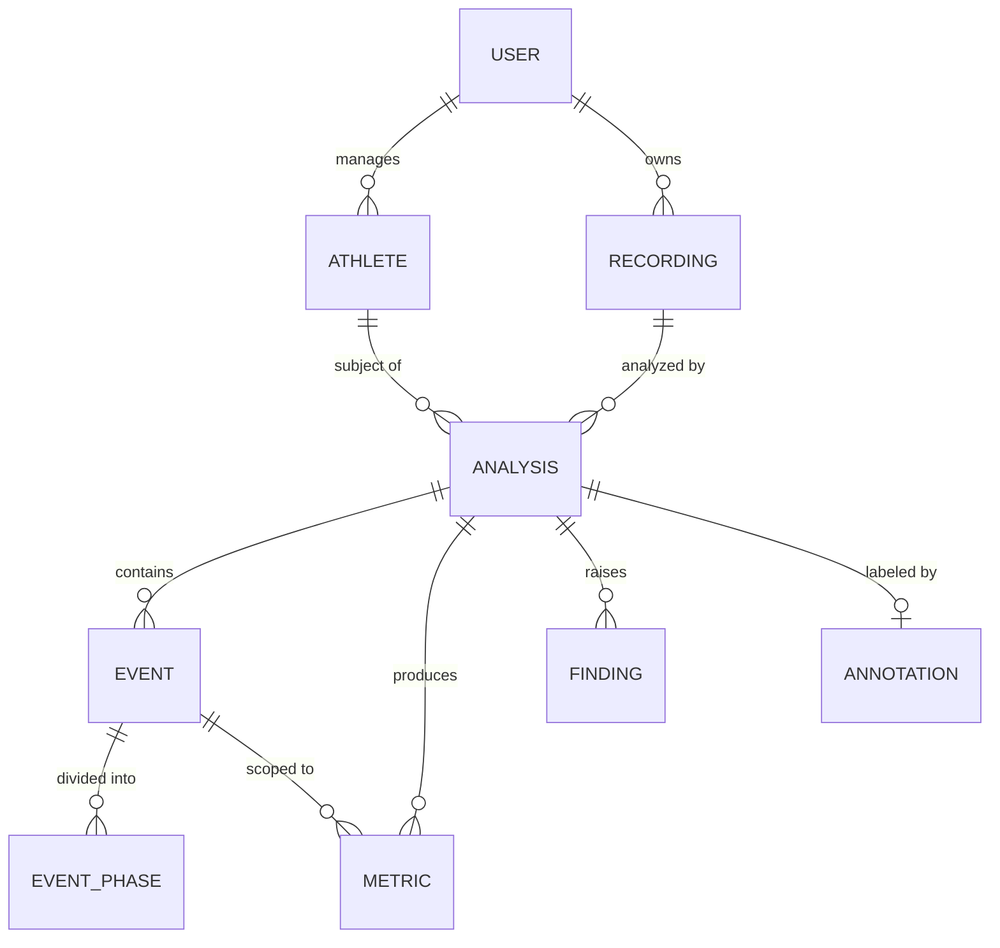
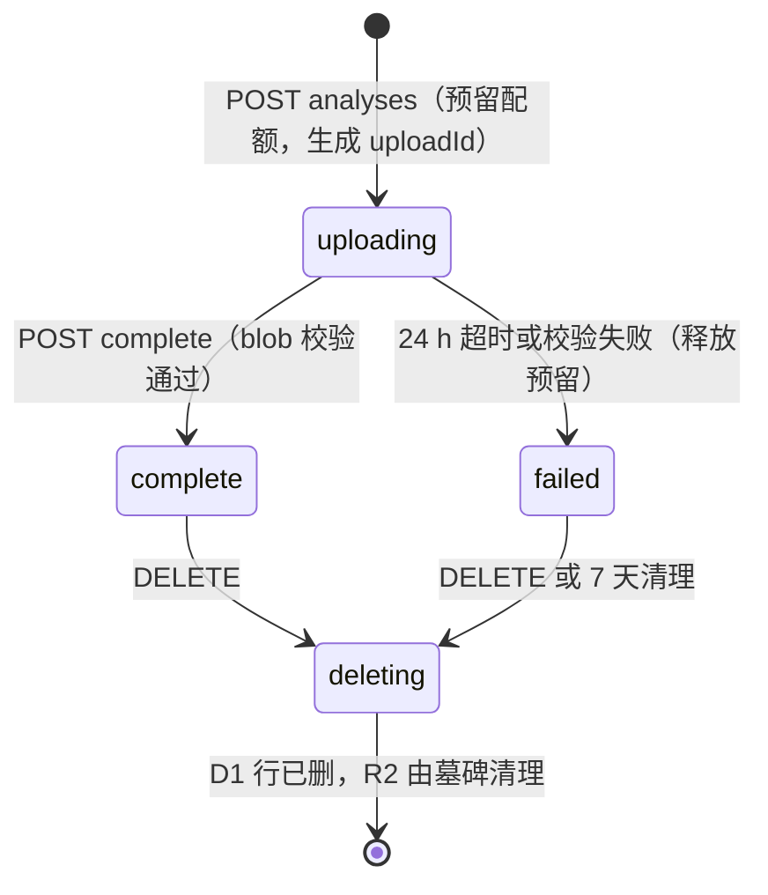

# 04 · 数据模型与 API

> 状态：v0.3 草案 · 更新：2026-10-30（athletes 增加 `backhand_type`，`dominant_hand` 允许 `unknown`，ADR-015；第 6 节补 P1 本地存储实现现状）

## 1. 数据分布原则

| 数据 | 存放位置 | 理由 |
|---|---|---|
| 原始视频 | **用户设备**（默认）；R2（P5，可选、需明确同意） | 隐私；体积大（样例 7.7 s = 51 MB） |
| 姿态文件 PTRK（原始 + 处理后） | 本地 OPFS；同步后 R2 | 核心资产，可重算分析（范围见 02 第 11 节） |
| 分析 manifest（输入、参数、版本快照） | 本地；同步后 R2 | 复现与可比性的依据 |
| 分析报告 JSON（完整结果、曲线） | 本地；同步后 R2 | 体积中等，按需读取；**不含图片** |
| 关键帧截图 | **只在本地**，从视频现场生成 | 截图会暴露人脸和环境，等同视频隐私级别 |
| 元数据、事件、指标 | 本地 IndexedDB；同步后 D1 | 需要 SQL 查询历史和趋势 |
| 标注 | 本地；同步后 R2 + D1 索引 | 验证与训练数据 |
| 模型文件 | 静态资源（lite/full）、R2（heavy） | 25 MiB 静态资源上限 |

**本地优先**：没有账号也能完整使用分析功能；云同步是增强功能。

**跨设备**（v1 不做，Q10）：在另一台设备上打开已同步的分析时，只能查看骨架、指标和曲线，状态显示"源视频不在本设备"；需要叠加回放时由用户重新选择同一视频（按 `video_sha256` 匹配）。

## 2. 领域模型



- **User**：登录身份。以 Access JWT 的 `iss` + `sub` 作为稳定标识；邮箱只是可变属性（用户改邮箱不会变成新用户）。
- **Athlete**：被分析的人（自己或学员），含持拍手（`dominant_hand`）、反手类型（`backhand_type`）、身高等用于分析的档案。不同球员持拍手不同，所以没有全局"我是右手"设置（ADR-015）。
- **Recording**：只描述**视频本身**（时长、帧率、编码、哈希）；不含视频本体，除非用户选择上传。一个视频里可能有多个人、多个动作，因此运动员和运动项目都**不挂在 Recording 上**。
- **Analysis**：对 Recording 中**某一个目标人物**、用某个运动包 + 推理提供者做的一次分析。运动员（`athlete_id`）和目标描述（选中的人、时间范围）都在这里；同一视频可分析多个运动员，或用不同包/版本重复分析。分析时的运动员档案、包配置、后处理参数都以快照形式写入 manifest（见 02 第 11 节），之后修改档案不影响旧结果。
- **Event / Phase / Metric / Finding**：见 [03-analysis-packs.md](./03-analysis-packs.md)。v1 的 Finding 只有测量说明（`category = 'measurement'`）。
- **Annotation**：针对某次分析的人工标注（rep 起止、最低点、击球时刻与类型），键为 analysis + athlete + pack，用于验证与训练。

## 3. D1 表结构（草案）

```sql
-- migrations/0001_init.sql（草案，尚未创建）
CREATE TABLE users (
  id             TEXT PRIMARY KEY,              -- ULID
  auth_issuer    TEXT NOT NULL,                 -- Access JWT iss（团队域）
  auth_subject   TEXT NOT NULL,                 -- Access JWT sub（稳定 ID）
  email          TEXT,                          -- 可变属性，每次登录刷新
  storage_bytes  INTEGER NOT NULL DEFAULT 0,    -- 已提交（complete）对象占用的 R2 空间
  reserved_bytes INTEGER NOT NULL DEFAULT 0,    -- 进行中上传预留的空间
  quota_bytes    INTEGER NOT NULL DEFAULT 1073741824,  -- 默认 1 GB
  status         TEXT NOT NULL DEFAULT 'active' CHECK (status IN ('active', 'deleting')),
  created_at     INTEGER NOT NULL,              -- unix ms
  UNIQUE (auth_issuer, auth_subject)
);

CREATE TABLE athletes (
  id             TEXT PRIMARY KEY,
  owner_id       TEXT NOT NULL REFERENCES users(id) ON DELETE CASCADE,
  display_name   TEXT NOT NULL,
  dominant_hand  TEXT NOT NULL DEFAULT 'unknown' CHECK (dominant_hand IN ('left', 'right', 'unknown')),   -- ADR-015
  backhand_type  TEXT NOT NULL DEFAULT 'two_handed' CHECK (backhand_type IN ('two_handed', 'one_handed', 'unknown')),
  height_cm      REAL,
  created_at     INTEGER NOT NULL
);
CREATE INDEX idx_athletes_owner ON athletes(owner_id);

-- 只描述视频本身
CREATE TABLE recordings (
  id            TEXT PRIMARY KEY,
  owner_id      TEXT NOT NULL REFERENCES users(id) ON DELETE CASCADE,
  camera_view   TEXT,                          -- side-left / side-right / front / back
  captured_at   INTEGER,
  duration_ms   INTEGER NOT NULL,
  fps           REAL NOT NULL,
  width         INTEGER NOT NULL,              -- 显示方向宽
  height        INTEGER NOT NULL,
  codec         TEXT,
  hdr           TEXT,                          -- none / hlg / pq
  video_sha256  TEXT NOT NULL,
  video_r2_key  TEXT,                          -- NULL = 视频仅在本地
  status        TEXT NOT NULL DEFAULT 'active' CHECK (status IN ('active', 'deleting')),
  notes         TEXT,
  created_at    INTEGER NOT NULL,
  UNIQUE (owner_id, video_sha256)
);
CREATE INDEX idx_recordings_owner ON recordings(owner_id, captured_at);

-- 一次分析 = 一个视频 × 一个目标人物 × 一个运动包版本 × 一套参数（recipe）
CREATE TABLE analyses (
  id                 TEXT PRIMARY KEY,
  owner_id           TEXT NOT NULL REFERENCES users(id) ON DELETE CASCADE,
  recording_id       TEXT NOT NULL REFERENCES recordings(id) ON DELETE CASCADE,
  athlete_id         TEXT REFERENCES athletes(id) ON DELETE SET NULL,
  sport              TEXT NOT NULL CHECK (sport IN ('gym', 'tennis')),
  pack_id            TEXT NOT NULL,             -- gym.squat
  pack_version       TEXT NOT NULL,
  provider_id        TEXT NOT NULL,             -- mediapipe.pose_landmarker_full@tasks-vision-1.2.0
  camera_view        TEXT,                      -- 分析时的视角（声明或估计），趋势只比较同视角
  target_json        TEXT NOT NULL,             -- 目标描述：选择方式、初始框、时间范围
  recipe_hash        TEXT NOT NULL,             -- manifest 规范化 JSON 的 SHA-256（见 02 第 11 节）
  compare_key        TEXT NOT NULL,             -- 包主版本 + 视角 + 关键后处理参数的哈希；趋势只比较相同 compare_key
  time_trusted       INTEGER NOT NULL,          -- 0/1，来自 timeMap.trusted
  status             TEXT NOT NULL CHECK (status IN ('uploading', 'complete', 'failed', 'deleting')),
  upload_id          TEXT NOT NULL,             -- 创建时由 Worker 生成，一次性；R2 key 含此 ID
  reserved_bytes     INTEGER NOT NULL,          -- 本次上传预留的配额
  quality_score      REAL,
  blob_bytes         INTEGER NOT NULL DEFAULT 0,  -- complete 时按 R2 实际大小写入
  created_at         INTEGER NOT NULL,
  completed_at       INTEGER
);
CREATE INDEX idx_analyses_recording ON analyses(recording_id);
CREATE INDEX idx_analyses_athlete ON analyses(athlete_id, pack_id, compare_key);
CREATE INDEX idx_analyses_status ON analyses(status, created_at);

-- 事件 ID 由 analyze() 确定性生成（rep-1、stroke-3 …），在分析内唯一
CREATE TABLE events (
  analysis_id  TEXT NOT NULL REFERENCES analyses(id) ON DELETE CASCADE,
  event_key    TEXT NOT NULL,
  kind         TEXT NOT NULL CHECK (kind IN ('rep', 'stroke')),
  label        TEXT NOT NULL,                  -- squat / partial / forehand / backhand / serve / unknown
  start_ms     INTEGER NOT NULL,
  key_ms       INTEGER NOT NULL,               -- 深蹲最低点 / 挥拍速度峰值
  end_ms       INTEGER NOT NULL,
  confidence   REAL NOT NULL,
  PRIMARY KEY (analysis_id, event_key)
);

CREATE TABLE event_phases (
  analysis_id  TEXT NOT NULL,
  event_key    TEXT NOT NULL,
  seq          INTEGER NOT NULL,
  phase        TEXT NOT NULL,                  -- descent / bottom / backswing / swing_peak …
  start_ms     INTEGER NOT NULL,
  end_ms       INTEGER NOT NULL,
  PRIMARY KEY (analysis_id, event_key, seq),
  FOREIGN KEY (analysis_id, event_key) REFERENCES events(analysis_id, event_key) ON DELETE CASCADE
);

-- 长表结构：新增指标无需改表；按 metric_key 查询趋势
CREATE TABLE metrics (
  analysis_id  TEXT NOT NULL REFERENCES analyses(id) ON DELETE CASCADE,
  event_key    TEXT NOT NULL DEFAULT '',       -- '' 表示汇总指标
  metric_key   TEXT NOT NULL,                  -- squat.knee_flexion_max
  side         TEXT NOT NULL DEFAULT '',       -- '' / left / right
  status       TEXT NOT NULL CHECK (status IN ('valid', 'unavailable', 'experimental')),
  value        REAL,                           -- unavailable 时为 NULL
  unit         TEXT NOT NULL,
  space        TEXT NOT NULL CHECK (space IN ('image', 'world', 'time')),
  reason_code  TEXT,                           -- unavailable / experimental 的原因
  PRIMARY KEY (analysis_id, event_key, metric_key, side)
);
CREATE INDEX idx_metrics_key ON metrics(metric_key, status, analysis_id);

CREATE TABLE findings (
  analysis_id    TEXT NOT NULL REFERENCES analyses(id) ON DELETE CASCADE,
  seq            INTEGER NOT NULL,
  code           TEXT NOT NULL,                -- v1：note.*
  category       TEXT NOT NULL CHECK (category IN ('measurement', 'coaching')),
  severity       TEXT NOT NULL CHECK (severity IN ('info', 'suggestion', 'warning')),
  message_key    TEXT NOT NULL,                -- i18n key，文案不入库
  message_params TEXT NOT NULL DEFAULT '{}',   -- JSON
  event_keys     TEXT NOT NULL,                -- JSON 数组
  evidence       TEXT NOT NULL,                -- JSON
  PRIMARY KEY (analysis_id, seq)
);

-- 标注本体在 R2（labels/{revision}.json），D1 只存索引（指向最新 revision）
CREATE TABLE annotations (
  analysis_id  TEXT PRIMARY KEY REFERENCES analyses(id) ON DELETE CASCADE,
  athlete_id   TEXT REFERENCES athletes(id) ON DELETE SET NULL,
  pack_id      TEXT NOT NULL,
  label_count  INTEGER NOT NULL,
  r2_key       TEXT NOT NULL,
  updated_at   INTEGER NOT NULL
);
CREATE INDEX idx_annotations_pack ON annotations(pack_id, athlete_id);

-- 待清理的 R2 前缀：D1 行先删，R2 对象由 Cron 按墓碑补删
CREATE TABLE r2_tombstones (
  prefix       TEXT PRIMARY KEY,               -- 例 u/{userId}/a/{analysisId}/
  owner_id     TEXT NOT NULL,
  reason       TEXT NOT NULL,                  -- deleted / abandoned_upload / failed
  created_at   INTEGER NOT NULL,
  attempts     INTEGER NOT NULL DEFAULT 0
);
```

说明：

- 主键用 ULID（客户端生成），离线创建后同步不冲突；事件以 `(analysis_id, event_key)` 为键，`event_key` 由 `analyze()` 确定性生成。
- D1 Free 单库上限 500 MB，单行 / BLOB ≤ 2 MB：**姿态与报告不进 D1**。完整分析结果（含逐帧曲线）在 R2 的 `report.json.gz`；D1 中的事件、阶段、指标、说明是为了查询与趋势而存的索引。
- 每次分析约 10–150 行（事件 + 阶段 + 指标），每行约 100–200 B，免费库可容纳数万次分析。
- D1 默认强制外键约束（迁移时可用 `PRAGMA defer_foreign_keys` 延迟检查，实施前以 D1 文档核对）；`ON DELETE CASCADE` 只清理 D1 行，R2 对象通过墓碑由应用层删除（见第 5.2 节）。
- **配额**：每个用户默认 **1 GB** R2 配额。一次 30 s 分析约 3–4 MB（原始 PTRK 1.2–1.8 MB + 处理后 PTRK 1.2–1.8 MB + 报告与 manifest 约 0.3 MB），1 GB 约可存 **250–350 次**。R2 免费额度 10 GB 为整个账号共享，所以免费层下最多约 10 个满额用户（见 05 第 3 节）。
- **保留**：`uploading` 超过 24 h 的分析由 Cron 标为 `failed` 并释放预留；`failed` 分析保留 7 天后删除。云端数据在用户主动删除前一直保留。

## 4. R2 对象布局

```text
action-tracker-data/
├─ u/{userId}/a/{analysisId}/{uploadId}/pose.raw.ptrk.gz
├─ u/{userId}/a/{analysisId}/{uploadId}/pose.ptrk.gz
├─ u/{userId}/a/{analysisId}/{uploadId}/report.json.gz
├─ u/{userId}/a/{analysisId}/{uploadId}/manifest.json
├─ u/{userId}/a/{analysisId}/labels/{revision}.json   # 标注可修改，每次保存新 revision
├─ u/{userId}/r/{recordingId}/video.mp4                # P5，可选
└─ models/mediapipe/tasks-vision-1.2.0/pose_landmarker_heavy.task
```

- 以 `u/{userId}/` 为前缀，Worker 根据登录身份拼接路径，**客户端不能指定任意 key**；`:name` 只接受白名单（`pose.raw` / `pose` / `report` / `manifest`）。
- **不可变 key**：`uploadId` 在创建分析时由 Worker 生成并存入 D1，只有该 ID 下的对象会被 `complete` 认可。重试上传写到同一 key；放弃的上传和旧 `uploadId` 下的对象由 Cron 当作孤儿清理。`complete` 之后不再接受对该前缀的写入。
- 标注挂在分析下面（同一视频的不同目标人物、不同运动包各有一份标注），D1 `annotations.r2_key` 指向最新 revision。
- `models/` 只读、公开，响应带 `Cache-Control: public, max-age=31536000, immutable`（路径含版本号）。
- **云端报告不含图片**：`report.json.gz` 只有数值、事件和曲线；关键帧截图只在本地从视频生成。

## 5. Worker API（v1 草案）

鉴权见第 5.1 节；请求与响应使用 zod schema 校验（`packages/shared`）。

| 方法 | 路径 | 作用 | 备注 |
|---|---|---|---|
| GET | `/api/health` | 健康检查 | **公开** |
| GET | `/api/auth/login` | 登录入口：顶层页面跳转到此路径，由 Access 完成登录后 302 回到 SPA | 受 Access 保护；**不能用 fetch 调用** |
| GET | `/api/me` | 当前用户（首次访问按 `iss + sub` 自动建档）、配额用量 | |
| DELETE | `/api/me` | 删除账号及全部云端数据（异步执行） | 需二次确认 |
| GET / POST | `/api/athletes` | 列表 / 创建运动员档案 | |
| PATCH / DELETE | `/api/athletes/:id` | 修改 / 删除 | |
| POST | `/api/recordings` | 创建录像元数据（按 `video_sha256` 幂等） | |
| GET | `/api/recordings?cursor=` | 分页列表 | |
| DELETE | `/api/recordings/:id` | 删除录像及其全部分析与 R2 对象 | 见 5.2 |
| POST | `/api/recordings/:id/analyses` | 创建分析（含 `athleteId`、`packId`、`target`、`recipeHash`、各 blob 的预计大小），**预留配额**，返回 `uploadId`；状态 `uploading` | 配额不足返回 413 |
| GET | `/api/analyses?athleteId=&packId=&cursor=` | 分页列表 | |
| PUT | `/api/analyses/:id/blobs/:name` | 上传 `pose.raw` / `pose` / `report` / `manifest`，**流式**写入 R2，带 `sha256` 由 R2 校验 | 仅 `uploading` 状态；`Content-Length` ≤ 该 blob 预计大小且 ≤ 10 MB（manifest ≤ 64 KB） |
| POST | `/api/analyses/:id/complete` | 校验 blob 后提交事件、阶段、指标、说明，状态 → `complete` | 请求体 ≤ 256 KB；见 5.2 |
| GET | `/api/analyses/:id` | 元数据 + 事件 + 阶段 + 指标 + 说明 | |
| GET | `/api/analyses/:id/blobs/:name` | 流式读取 R2 对象 | |
| DELETE | `/api/analyses/:id` | 删除一次分析 | 见 5.2 |
| GET / PUT | `/api/analyses/:id/annotations` | 读取 / 保存标注（新 revision + D1 索引） | 可在 `complete` 后修改 |
| GET | `/api/athletes/:id/trends?metric=&packId=&compareKey=&from=&to=` | 某指标随时间变化 | 按 `recordings.captured_at`（缺失时用分析创建时间）排序；只返回 `status = 'valid'` 且 `compare_key` 相同的结果 |
| GET | `/models/*` | 读取 R2 中的大模型 | **公开** |

**归属检查**：每个请求都按登录用户检查**所有被引用的行**（`recording_id`、`athlete_id`、`analysis_id`）属于该用户，用 `INSERT … SELECT … WHERE EXISTS (…owner_id = ?)` 在同一条 SQL 中完成，避免先查后写的竞态。

### 5.1 鉴权（Cloudflare Access，按路径保护）

- **只保护 `/api/*`（除 `/api/health`）**；SPA 静态资源、`/models/*` 公开。这样匿名用户也能打开应用、下载模型、完全在本地分析，只有云同步需要登录。
- **登录**：fetch 请求遇到 Access 的跳转会因 CORS 失败，所以客户端在 `/api/me` 返回 401 或被重定向时，**用顶层导航**跳转到 `/api/auth/login`；Access 登录完成后，该路由 302 回到 SPA，之后同源 fetch 自动携带 `CF_Authorization` cookie。
- **Worker 内校验 JWT**（不只依赖 Access 在边缘拦截）：读取 `Cf-Access-Jwt-Assertion` 头；用团队域的 JWKS 校验 RS256 签名，检查 `iss`、`aud`（应用 AUD tag）、`exp`；JWKS 缓存在内存/Cache API 中，遇到未知 `kid` 时重新拉取一次（应对密钥轮换）。
- **workers.dev 上的配置方式**（已查官方文档 2026-10-29，部署时实测）：
  - 在 Zero Trust → Access → Applications 中创建 **self-hosted 应用**，应用域名填 `action-tracker.<子域>.workers.dev/api`（文档说明 self-hosted 应用的域名可以是 workers.dev 主机名、自定义域名或路径）。
  - **不要**在 Worker 设置中使用"保护此 Worker"（Worker 级 Access）：它会保护该 Worker 的全部域名和路径，包括 SPA，匿名用户将无法使用。
  - `/api/health` 用一个路径更具体的 Bypass 应用放行；如果实测不支持，就把健康检查改到 `/health`。
  - preview 版本 URL 可以单独开启"仅保护 preview"，避免未发布版本被公开访问。
  - 因此**不需要自定义域名**；若实测按路径保护在 workers.dev 上不可用，再评估自定义域名（Q7）。

### 5.2 分析生命周期（上传、完成、删除）



所有状态迁移都是**条件更新**（`UPDATE … WHERE id = ? AND owner_id = ? AND status = '<期望状态>'`），并与相关的配额计数放在**同一个 `db.batch()`**（事务）中，因此并发请求或重放只会生效一次。

- **创建与预留**：客户端声明各 blob 预计大小（合计 ≤ 4 × 10 MB）。一个 batch 内：①`UPDATE users SET reserved_bytes = reserved_bytes + :n WHERE id = :uid AND storage_bytes + reserved_bytes + :n <= quota_bytes`；②`INSERT INTO analyses … SELECT … WHERE changes() = 1 AND EXISTS (recording 属于该用户) AND (athlete 为空或属于该用户)`。插入行数为 0 时返回 413 或 404。（`changes()` 在 batch 中的行为实施时核对；不可用时改为在 ② 中重复写配额条件。）
- **上传**：只在 `uploading` 状态、且 key 中的 `uploadId` 与 D1 一致时接受。客户端在请求头附带 blob 的 SHA-256（覆盖**压缩后的上传字节**），Worker 调用 `env.DATA.put(key, request.body, { sha256 })`，由 R2 存储层校验，不一致时写入失败。不再把客户端自报的哈希当作自定义元数据保存。
- **完成**：Worker 对每个必需 blob 做 `head()`，确认存在、实际大小 ≤ 预留、校验和与声明一致（读取 `R2Object.checksums`，实施时核对字段）。然后一个 batch：①`UPDATE users SET storage_bytes = storage_bytes + :actual, reserved_bytes = reserved_bytes - :reserved WHERE id = :uid AND EXISTS (SELECT 1 FROM analyses WHERE id = :aid AND owner_id = :uid AND status = 'uploading')`；②事件/阶段/指标/说明用 `INSERT … SELECT … WHERE EXISTS (…status = 'uploading')`；③`UPDATE analyses SET status = 'complete', blob_bytes = :actual, completed_at = ? WHERE id = :aid AND owner_id = :uid AND status = 'uploading'`。重放时三步都不生效，结果幂等，配额只计一次。**`complete` 之后 blob 和指标都不可覆盖**；需要重算时创建新的分析。
- **删除**（幂等，可重试）：一个 batch 内 ①条件更新状态为 `deleting`；②插入墓碑 `r2_tombstones(prefix = u/{userId}/a/{analysisId}/)`；③扣减 `storage_bytes`（或释放 `reserved_bytes`）；④删除 D1 行。之后 Worker 尝试按前缀删除 R2 对象，成功后删除墓碑；失败的由 Cron 按墓碑重试。删除录像和账号时按同样顺序处理其下全部分析。
- **Cron 清扫**（每日）：①`uploading` 超过 24 h → `failed` 并释放预留；②`failed` 超过 7 天 → 走删除流程；③处理墓碑；④按前缀抽查不属于任何当前 `upload_id` 的孤儿对象并删除。每次只处理有限数量，避免超出单次调用限制。

### 设计要点（Workers Free 10 ms CPU）

- **不缓冲大请求体**：`env.DATA.put(key, request.body)` 直接把请求流写入 R2，Worker CPU 几乎只花在路由与鉴权上。
- **批量写**：一次 `complete` 把所有事件、阶段与指标合并为一次 `db.batch()`（单条语句最多 100 个绑定参数，需分块生成多条 INSERT）。
- **不在 Worker 中解析 PTRK 或计算指标**：指标由客户端计算，服务端只做 schema 校验与归属检查。
- **幂等**：客户端生成 ID；重复提交返回已存在记录，便于离线重试。
- **JWT 校验成本**：RS256 验签使用原生 `crypto.subtle`，JWKS 缓存避免每次请求都发子请求；P3 实测单次请求 CPU 是否在 10 ms 内。
- **视频上传（P5）**：使用 R2 预签名 URL 或分片上传，浏览器直传 R2，绕过 Worker 请求体限制与 CPU。

### 错误格式

```json
{ "error": { "code": "VALIDATION_FAILED", "message": "…", "details": [] } }
```

## 6. 本地存储（浏览器）

| 存储 | 内容 |
|---|---|
| IndexedDB `action-tracker` | athletes、recordings、analyses、events、event_phases、metrics、findings、annotations（与 D1 同构）+ `sync_state` |
| OPFS | `/{recordingId}/{analysisId}/pose.raw.ptrk.gz`、`pose.ptrk.gz`、`report.json.gz`、`manifest.json`、`labels.json`；进行中的分析写在 `/tmp/{jobId}/`，完成后再提交（见 02 第 12 节） |
| 不存 | 视频本体（每次分析通过文件选择器重新提供；可选保存 `FileSystemFileHandle` 以便重新打开） |

**P1 实现现状**（2026-10-30）：IndexedDB `action-tracker` v1 只有 `recordings`（`videoSha256` 唯一索引）和 `analyses`（索引：`recordingId`、`videoSha256`、`createdAt`）两个 store，其余 store 在对应功能实现时加版本升级。OPFS 暂用扁平的 `analyses/<analysisId>/raw.ptrk.gz` + `manifest.json`，没有 tmp 目录；完成标记与对账规则见 [02 第 13 节](./02-pose-pipeline.md)。iOS Safari 不支持 `showOpenFilePicker`，因此不保存 `FileSystemFileHandle`，重新打开时让用户再选一次视频并按 SHA-256 校验。

**存储配额与持久化**：

- 首次保存分析时调用 `navigator.storage.persist()` 申请持久化存储，降低浏览器在空间不足时清除数据的可能（Safari 尤其会清理长期未访问站点的数据）。
- 每次写入前用 `navigator.storage.estimate()` 检查剩余空间；不足时提示用户清理旧分析或导出，写入失败（`QuotaExceededError`）时保留内存中的结果并提示导出，不静默丢失。
- **导出/导入**：单次分析导出为一个 zip，包含 `pose.raw.ptrk.gz`、`pose.ptrk.gz`、`manifest.json`、`report.json.gz`、`labels.json`（如有）。未登录用户也能备份和迁移。导出功能只有在**真实导入回来并得到相同结果**（`recipeHash` 一致、指标逐字节一致）的测试通过后才算完成；导入时按 02 第 9 节的读取校验处理不可信文件。

同步策略：本地记录带 `syncState: local | pending | synced | conflict`；上传顺序 recording → analysis（`uploading`，拿到 `uploadId`）→ blobs → complete；失败自动重试。v1 以"本地新建 → 上传"为主，多设备双向同步留到后续。
