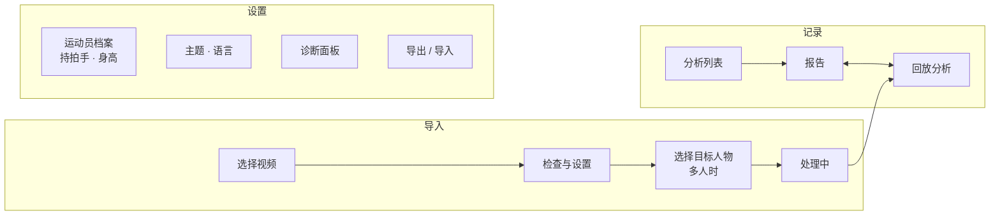
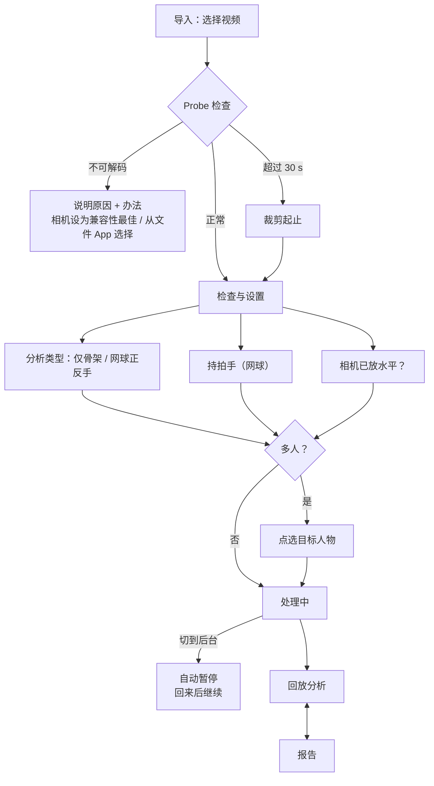

# 08 · UI / UX 设计

> 状态：v0.1 草案（仅设计，未实现）· 更新：2026-10-29
> 依据：[ui-ux-pro-max](https://github.com/nextlevelbuilder/ui-ux-pro-max-skill) 技能生成并核对的设计系统 [design-system/action-tracker/MASTER.md](./design-system/action-tracker/MASTER.md)；产品约束来自 [01](./01-architecture.md)、[02](./02-pose-pipeline.md)、[03](./03-analysis-packs.md)、[07](./07-mobile-web.md)。
> 静态原型：[mockups/ui-mockup.html](./mockups/ui-mockup.html)；shadcn 风格备选 A / B / C：[A](./mockups/mock-ui-shadcn.html)、[B](./mockups/mock-ui-shadcn-b.html)、[C](./mockups/mock-ui-shadcn-c.html)（见第 11.2 节；均可本地直接打开，不需要服务器，未部署）。

## 1. 设计原则

1. **视频与骨架是主角**：界面装饰最少（Minimalism & Swiss Style），深色默认。
2. **测量诚实**（ADR-011/012）：每个数值都带状态；不可用就显示"—"和原因，不猜；不评分、不纠错。
3. **iPhone 单手可用**：主要操作在屏幕下半部；触控目标 ≥ 44 px；尊重安全区。
4. **一屏一个主操作**：主按钮橙色，每屏最多一个。
5. **可追溯**：任何数值都能回到视频中的对应帧（点数值 → 跳到该时刻）。

## 2. 用户与使用场景

| 场景 | 使用者 | 设备 | 关注点 |
|---|---|---|---|
| 训练后在场边回看 | 本人 | iPhone 竖屏，户外强光 | 快速导入、看骨架、看几个关键数值；浅色主题 |
| 回家细看 | 本人 | iPhone 横屏 / 桌面 | 逐帧、曲线、对比同一动作的多次重复 |
| 教练试用 | 少量教练（Q3） | iPhone / iPad | 和运动员一起看回放；暂停在关键帧讲解 |

## 3. 信息架构

底部标签栏 3 项：**记录 / 导入 / 设置**。

- 处理完成后直接进入**回放分析**；从记录进入时默认打开**报告**，两者用顶部分段控件切换（回放 | 报告）。
- 标注工具（P2）作为回放页的一个模式，不单独占标签。
- 云同步（P3）出现前，界面上不显示账号、同步相关入口。

## 4. 主流程

## 5. 页面

### 5.1 记录（分析列表）

- 顶部：标题 + "导入视频"主按钮（列表为空时居中显示，并附三条拍摄要点）。
- 每条记录卡片：分析类型、拍摄日期、时长、摘要（如"挥拍 12 次 · 正手 8 · 反手 4"）、状态摘要（"2 项不可用"）。缩略图只来自本地 OPFS，不上传。
- 原视频已被系统清除或换设备时（ADR-002）：卡片标"无原视频"，回放只播骨架动画（不用"仅骨架"，该词是分析类型名称）。
- 长按或左滑删除；**必须**另有"更多 → 删除"按钮作为替代（不只靠手势）。

### 5.2 检查与设置

上半部分是视频首帧（含旋转），下半部分是设置卡片，底部固定主按钮"开始分析"。

| 区块 | 内容 |
|---|---|
| 视频信息 | 分辨率、帧率、时长、编码、HDR；**时间可信**状态（慢动作时显示警告："速度和节奏将不可用"）；从相册选择后被转码时提示改用"文件"App |
| 分析类型 | 分段控件：**仅骨架**（P1 默认，sample1 用）/ **网球 · 正反手**（`tennis.groundstroke`）；Gym 类型 P2 起出现 |
| 持拍手 | 右 / 左（来自运动员档案，可临时修改；只影响本次快照） |
| 竖直参考 | 开关"三脚架已放水平"；关闭时说明"躯干前倾等角度将不可用"；P2 可选"在画面上画竖直线" |
| 拍摄检查（软提示） | 人物过小、视角不符、HDR → 黄色警告卡片（图标 + 文字），不阻止继续 |

### 5.3 选择目标人物（仅多人时）

- 在首个清晰帧上为每个候选人画框和编号；默认高亮最大且最居中的人。
- 点框选择；同时提供"上一个 / 下一个候选"按钮和列表（不只靠点画面）。

### 5.4 处理中

- 分步进度：解码 → 推理 → 后处理 → 分析 → 保存，当前步骤显示帧数 `n / N` 和剩余时间估计。
- 实时预览：每秒更新一次当前帧的骨架缩略图（限频，见 02 第 8 节）。
- 操作：**暂停 / 继续**（次按钮）、**取消**（文字按钮，需确认）。
- 提示条："请保持此页面在前台，屏幕常亮"；Wake Lock 不可用（iOS < 18.4、内置浏览器）时改为"请手动保持屏幕常亮"。
- 切后台后回来：顶部提示"已在第 n 帧暂停，正在继续"（02 第 12 节、07 M6a）。
- GPU → CPU 回退时：一行说明"已切换到兼容模式，速度会变慢"，不弹窗打断。

### 5.5 回放分析（核心页面）

**竖屏布局（自上而下）**

| 区域 | 高度（393 × 852 为例） | 内容 |
|---|---|---|
| 顶栏 | 44 + 安全区 | 返回、文件名、分段控件 **回放 | 报告**、更多 |
| 视频舞台 | 最多约 50% 可视高度 | 视频 + 骨架叠加（`object-fit: contain`，黑底）；双击切换"专注模式"（隐藏下方面板，只留控制条） |
| 控制条 | 52 | −1 帧、播放/暂停、+1 帧、速度（0.25 / 0.5 / 1×）、上/下一个事件 |
| 时间轴 | 40 | 进度、事件标记（挥拍：三角；rep：竖条）、`unavailable` 时段阴影 |
| 关节选择 | 44 | 关节组芯片（见第 6 节），可横向滚动并支持换行 |
| 角度曲线 | 约 140 | uPlot；与播放头同步；点击跳转 |
| 当前值 | 自适应 | 当前帧选中关节的角度卡片；当前事件的指标（带状态标签） |

**横屏布局**：视频居左约 60%，右侧为控制条、曲线和数值面板；控制条固定在视频下方。

**图层开关**（更多菜单，或视频右上角的图层按钮）：骨架、关键关节与角度、插补点（默认显示为虚线/空心）、人物框、中线（竖直参考）。

### 5.6 报告

自上而下：

1. **质量摘要**：时间可信、竖直参考、目标人物观测比例；有问题时以警告卡片显示（含图标与原因）。
2. **汇总指标**：大号数值卡片（系统字体 Display 600，`tabular-nums`）。每张卡：名称、数值 + 单位、状态标签；`experimental` 标"实验"；`unavailable` 显示"—"和一句原因。
3. **事件列表**：如"#3 正手 · 速度峰值 00:03.42 · 置信度高"；点击跳到回放页该时刻。
4. **测量说明**（`notes`，只有 `measurement` 类）：如"慢动作视频：节奏指标不可用"。
5. **导出**：zip（PTRK、manifest、labels、报告），见 04。

报告中**不出现**评分、等级、"好/差"、建议性语句。

### 5.7 设置与诊断

- 运动员档案：持拍手、反手类型（单手 / 双手，Q12）、身高（可选，用于 m/s 换算）。
- 主题：跟随系统 / 深色 / 浅色。语言：**界面只做英文**（2026-10-29 用户确认，Q13）；文案仍通过 `messageKey` 管理（见 03 `Finding`），暂不提供语言切换。
- 诊断面板（07 第 5 节）：能力探测结果、各阶段耗时、内存估计、GPU/CPU、错误日志；"导出诊断 JSON"（默认不含帧和姿态数据）。

### 5.8 标注模式（P2）

回放页的一个模式：在时间轴上添加/拖动事件，选择类型（正手/反手/空挥/不计）。拖动均有"−1 帧 / +1 帧 / 设为当前帧"按钮替代。P1 阶段 labels 仍手写 JSON（03 第 7 节）。

## 6. 骨架与关键关节显示（P1 首个里程碑）

颜色、线型、描边见 [MASTER 第 3.3 节](./design-system/action-tracker/MASTER.md)。

### 6.1 关节组预设

| 分析类型 | 默认关节组 | 显示的角度 |
|---|---|---|
| 仅骨架（sample1，单腿蹲，**正面**拍摄） | **支撑腿（左）**：髋、膝、踝（自动取支撑侧：脚踝竖直速度更小、visibility 更高的一侧，可手动切换） | 正面：**膝 FPPA**（额状面投影角，内／外偏）、**髋下降**（% 腿长）、骨盆倾斜（实验）；**膝屈曲不可用**（正面拍摄时膝向镜头移动，2D 角度严重偏小，需侧面拍摄）。侧面拍摄时：髋屈曲、膝屈曲、踝角 |
| 网球 · 正反手 | **持拍侧**：肩、肘、腕；双膝 | 肘角、膝屈曲；手腕速度曲线（torso/s） |
| Gym 深蹲（P2） | 近相机侧：髋、膝、踝；躯干 | 膝屈曲、髋屈曲、躯干前倾（需竖直参考） |

芯片示例：`支撑腿 髋·膝·踝`（默认）、`右膝`、`左膝`、`躯干`、`持拍手`、`自定义…`。选中芯片后：视频上对应关节以黄色放大显示并画角度弧线；曲线区显示对应角度；当前值卡片同步。

### 6.2 角度定义与标注

- 显示**关节屈曲角**（与 03 指标一致，如膝屈曲 = 180° − ∠髋膝踝），标签写全称"膝屈曲 55°"，避免与内角混淆；曲线 Y 轴同名同单位。
- 角度依赖的三个点任一非 `observed` 时：标签变为灰色并加"（补）"，曲线该段降为 40% 不透明度并在 X 轴上方标出"补点"带（见 MASTER 3.4）。
- 需要竖直参考的角度（躯干前倾）在 `verticalReference = none` 时不画，并在曲线区说明原因。

### 6.3 图例

视频舞台左下角折叠式图例（默认收起，点"图例"展开）：左/右侧颜色、骨架上实线实心点 = 观测、虚线空心点 = 插补、黄色 = 选中关节；曲线区另有系列标注与"补点"带说明。

### 6.4 骨架叠加在真实身体上（用户确认的显示方式）

- 骨架**直接画在原视频画面的人体上**，不用合成人形或球场示意图；原视频不可用时才退回"仅骨架动画"。
- 样式：**白色骨线**（约 3 px，外加深色描边保证亮背景可见），关节点左青 `#22d3ee`、右橙 `#f97316`，选中关节黄色放大；visibility < 0.5 的关节画空心点、相连骨线画虚线。
- **跟随人体取景**：舞台按目标人物在整段视频中的外接框（含头顶余量）裁切放大，人物不再缩在竖屏画面中间；保持原比例，不变形。
- 角度弧线画在选中关节上，数值标签放在肢体外侧，不压住骨线。
- 实现：`<video playsinline muted>` 只负责解码（不直接显示），每帧用 `drawImage` 把视频画进 canvas，再用同一坐标变换画骨架；播放时以 `requestVideoFrameCallback` 同步，`timeupdate` 兜底。
- 实测（sample1，Pose Landmarker heavy，离线）：232 帧（30 fps 抽样）全部检出；抬起腿的脚踝、足跟常被支撑腿遮挡（visibility 低），正好用来演示空心／虚线。

## 7. 状态与文案

### 7.1 指标状态

见 MASTER 第 3.2 节：`valid` 绿色 ✓ "Valid"；`experimental` 紫色 "Experimental"；`unavailable` 灰色 "Unavailable" + 原因。所有状态都是**图标 + 文字**。

### 7.2 `reasonCode` 文案（界面英文）

| reasonCode | 简短文案（卡片内） | 详情（点开） |
|---|---|---|
| `time_untrusted` | Time not trusted | Slow-motion or variable-frame-rate video has no reliable real time, so speed and tempo can't be measured. Record at a normal 60 fps. |
| `insufficient_observation` | Insufficient observation | A required joint was missed for too long in the key window (tennis: 40 ms). Try better light, less occlusion or a closer camera. |
| `depends_on_interpolation` | Key moment interpolated | The joint position at the key moment was filled in from neighbouring frames, not observed. |
| `keypoint_occluded` | Joint occluded | A required joint was hidden during the key window. |
| `no_vertical_reference` | No vertical reference | Angles relative to vertical need a level camera. Confirm it on import, or draw a vertical line (P2). |

### 7.3 用词表

| 用 | 不用 | 原因 |
|---|---|---|
| Speed peak | Contact, hit, impact | 03 第 5.2 节 |
| Swing | Shot, hit（指事件时） | 空挥也是事件 |
| Measurement note | Tip, issue, error, advice | ADR-012 |
| Unavailable（显示"—"） | 0, N/A, estimate | ADR-011 |
| Experimental | Beta, for reference only | 统一术语 |
| Valid | OK, good, pass | 只表示满足测量条件，不是评价动作 |

## 8. iPhone 细节

- `<video playsinline muted>`；回放用 `requestVideoFrameCallback` 同步骨架（07）。
- 文件选择：`<input type="file" accept="video/*">`；Probe 后显示实际编码，若与相机设置不符则提示被转码（07 M1）。
- 在 App 内置浏览器打开时，顶部提示"请在 Safari 中打开"（文件访问与 Wake Lock 受限）。
- 固定栏使用 `env(safe-area-inset-*)`；`viewport-fit=cover`。
- 输入框字号 ≥ 16 px，避免自动放大。
- 不依赖悬停；所有提示可点击查看。
- 横屏时隐藏底部标签栏，最大化视频。

## 9. 可访问性

- 正文对比度 ≥ 4.5:1，控件边界 ≥ 3:1（两套主题都已计算，见 MASTER）。
- 颜色不单独承载信息：状态、左右侧、插补都有形状/文字区分。
- 所有拖动操作有按钮替代（时间轴、曲线、标注）。
- 读屏：播放器控件有 `aria-label`；当前角度变化不做实时朗读（避免刷屏），暂停时可读出当前值。
- `prefers-reduced-motion`：关闭过渡与加载动画；视频播放不受影响。
- 文字放大到 200% 时卡片换行，不截断数值。

## 10. 里程碑映射

| 阶段 | UI 范围 |
|---|---|
| **P1** | 导入 → 检查与设置（仅骨架 / 网球正反手）→ 处理中（暂停/继续）→ 回放分析（骨架、**关键关节与角度曲线**、kpState 显示）→ 报告（网球指标与状态）；诊断面板；深/浅主题 |
| P2 | Gym 分析类型；标注模式；画竖直线；数据表视图 |
| P3 | 账号（Access）与同步状态、历史趋势图（只含 `valid` 且同 `compare_key`） |

## 11. 原型

[mockups/ui-mockup.html](./mockups/ui-mockup.html) 展示 5 个竖屏页面（记录、检查与设置、处理中、回放分析、报告），可切换深/浅主题。说明：

- 是静态示意，不含真实视频、MediaPipe 或数据；骨架坐标为手绘示意（sample1 单腿蹲姿态）。
- 图标为内联 SVG 示意；实现时使用 Phosphor。
- 原型使用系统字体回退，不请求任何外部资源。
- 初始主题跟随系统（`prefers-color-scheme`），页面顶部可手动切换深 / 浅。
- 回放页示例为 sample1 第 192 帧：髋屈曲 39°、膝屈曲 55°、踝角 89° 由示意坐标按第 6.2 节定义计算；左腕演示插补点。报告页为网球示例数据（虚构）。

### 11.1 shadcn 风格备选原型

[mockups/mock-ui-shadcn.html](./mockups/mock-ui-shadcn.html) 是用户要求新增的独立备选，不替换上述原型或 MASTER，不代表已确认新的设计系统。

- 依据用户级 `shadcn` skill 与官方 Button、Tabs、Dialog、Slider、Switch、Toggle Group 文档，将 token、variant 和交互原则适配为单文件原生 HTML/CSS/JavaScript；**不是已安装的 React / Base UI / Radix 组件**，不新增应用脚手架或依赖。
- 以网球正反手为主，展示普通 60 fps、约 30 s 片段的回放／测量报告；桌面双栏，手机单栏与底部导航。保留橙色强调、青／橙骨架、三类指标状态；中性底色与较小圆角仅为本备选的视觉探索。
- 包含播放／暂停、按 60 fps 示例网格逐帧、时间轴／曲线跳转、事件选择、关节信号／数据表、报告、深浅主题、图层开关和 JSON 导出。导出标明示例或未分析，不伪装成完整 PTRK 备份。
- 网球场、人物、轨迹和数值为合成演示，不读取现有视频。官方 Phosphor regular SVG 图标内嵌，无第三方运行时请求。
- 可通过文件选择器打开本地视频，只作预览：不运行 MediaPipe，不输出真实测量；源帧率未验证时的 1/60 s seek 不宣称为源视频精确逐帧。离开页面会释放视频引用，不保存或上传原片。
- 本原型不构成 iPhone 性能、姿态准确性或真实源视频帧精度的验收；需在 P1 真正接入管线后另行实测。
- 已在桌面浏览器中用深、浅两套主题渲染检查；真机（iPhone Safari）检查留到 P1 实现阶段。

### 11.2 shadcn 三个备选（A / B / C，界面英文；2026-10-29 用户选定 C）

用户偏好 shadcn 方向，要求再出两版比较；三版均为英文界面、单文件、无外部请求、合成示例数据，共用同一套状态规则（图标 + 文字、"—" + 原因、实验不进趋势、插补 40% 不透明度、骨架左青右橙选中黄）。

| 方案 | 文件 | shadcn style | 布局思路 | 适合 |
|---|---|---|---|---|
| A · Workbench | [mock-ui-shadcn.html](./mockups/mock-ui-shadcn.html) | nova（紧凑，6 px 圆角） | 单页工作台：回放 + 检查器双栏，标签切换回放／报告 | 桌面细看单个片段 |
| B · Library + Session | [mock-ui-shadcn-b.html](./mockups/mock-ui-shadcn-b.html) | lyra（方正，2 px 圆角，等宽数字） | 侧边栏 + 记录库数据表（搜索、筛选、处理状态）→ 会话仪表盘（KPI、回放、信号曲线、数据质量、挥拍表） | 管理多段视频、给教练看 |
| C · Mobile focus | [mock-ui-shadcn-c.html](./mockups/mock-ui-shadcn-c.html) | maia（柔和，14–20 px 圆角，胶囊控件） | iPhone 优先：全宽画面 + 胶囊播放条 + 可拖动底部抽屉（peek / half / full）；≥ 960 px 时抽屉变右侧栏；"Single-leg squat"（**sample1 真实视频 + 真实 MediaPipe 骨架**，膝 FPPA 弧、髋下降、3 次下蹲最低点）与 "Tennis groundstrokes"（合成示意，暂无网球视频）两种模式 | 球场边单手操作 |

- **C 的 Single-leg squat 模式已改为真实数据**（用户要求"骨架画在真实身体上"）：素材在 [mockups/assets/](./mockups/assets/)——`sample1-360p.mp4`（360 × 640 H.264，30 fps，本地由 sample1 缩小转码，原文件未改动）与 `sample1-pose.json`（MediaPipe Pose Landmarker heavy 在本机离线推理的 33 点结果）；页面内嵌了其中 17 个关节。
- 视频需通过本地 HTTP 打开（如在 `designs/mockups` 下运行 `python -m http.server`，访问 `http://127.0.0.1:8000/mock-ui-shadcn-c.html`）；VS Code 内置浏览器以 `file://` 打开时会拦截视频，此时只显示骨架。
- A、B 仍为合成画面；选定方案后把 6.4 的叠加方式移植过去。

- 已在桌面浏览器检查 1440 px 浅色与 390 × 844 深色：无横向溢出、无脚本错误；C 的抽屉吸附、模式切换和曲线跳转已验证。
- 选定后再把 shadcn/ui token（zinc 中性色）与 MASTER（slate）统一，并决定是否在 01 / ADR 中正式采用 shadcn/ui + Tailwind。
